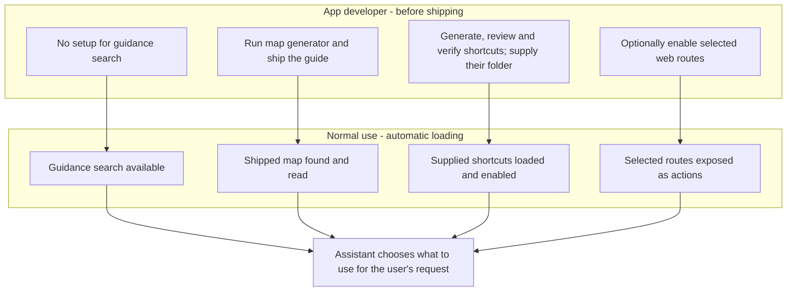

# aiify agent guide

Package version: `0.5.0`

Read-only usage guide generated from the package's public context module.

Structured companion: `aiify_context.json`.

## Reader

```python
from aiify import context; context.read(format='json')
```

## What ai-ify does (`overview`)

````markdown
ai-ify 0.5.0 — What ai-ify does

ai-ify puts an AI agent inside an app. The person chats with it in a panel on
the app's page, or opens the same conversation in a terminal. The agent runs on
the Claude or Codex subscription already signed in on the computer (no API key),
and can change the app only in the ways its developer allows:

1. Backend actions: Python functions the app exposes, each marked as
   read-only, changing data, or destructive. Destructive ones ask the person first.
2. Named UI commands: page functions registered with `window.aiify.registerTool`,
   such as "switch to the plots view".
3. The control tree: every visible button, field and menu on the page, so the
   agent can click or fill controls nobody named in advance.

The agent reaches the running app through a local control port with the `aiify`
command (`aiify action.list`, `aiify ui tree`). The app decides which profiles the
person can pick, what each may run, and what extra instructions apply in which state.

Start with `context.read("features")` for all features, configuration options
and links to detailed usage. Read `integration` to choose how to embed ai-ify,
`best-practices` for a complete implementation recipe and recommended patterns,
or `programmatic` to call it from application code. Read `quickstart` for the
smallest runnable example, or `agent-commands` to use an existing integration.

Minimal use in a FastAPI app:

```python
from aiify import Agent, Profile
agent = Agent(app="myapp", actions={"notes.add": add_note},
              profiles={"default": Profile(provider="claude")})
agent.mount(fastapi_app)      # then add <script src="/aiify/panel.js" defer></script> to the page
```

Read a topic with `context.read("<topic>")`; search with `context.search("<words>")`.

## Read the guide without starting an assistant

```python
from aiify import context

print(context.read("features"))
result = context.search("scheduled messages", limit=3)
assert result["ok"]
for match in result["results"]:
    print(match["topic"], match["description"])
structured = context.read("best-practices", format="json")
assert structured["ok"]
```

Reads and searches are offline and read-only. They do not start an app, import
its assistant backend or contact a provider. Structured reads include version,
topic, title, content, prerequisites and related topics. Required prerequisites
are included in the content; follow optional related topics when needed.
Unknown topics return helpful errors and available names (`ok: false` in JSON).
Search results have stable topic names and relevance descriptions; no match is
an empty list. `truncated: true` means more results exist; increase `limit` or
use a more specific query. Terminal reads/searches print JSON:
`python -m aiify.context features` or `python -m aiify.context --search "queue"`.
Agents without Python can read the generated portable Markdown or JSON guide.

Topics:

- `features` — All features and configuration options: Complete feature catalogue, defaults, option meanings and links to usage recipes.
- `best-practices` — Build a reliable assistant integration: Working recipe for actions, profiles, context, hooks and launches; deployment and verification practices.
- `programmatic` — Use the assistant from application code: Lifecycle, messages, events, configuration, one-off structured questions and pending work.
- `integration` — Embed ai-ify in another application: Choose an integration, connect existing functions and verify the result without a paid agent.
- `host-runner` — Shared panel for an existing task runner: Reuse the chat interface while retaining host queues, reviews and provider sessions.
- `messaging` — Messages between connected assistants: Named recipients, reply threads and durable message receipts without automatic model turns.
- `models` — Available models and selection: Claude and Codex adapter choices, account availability, defaults and verified Sonnet 5.5 evidence.
- `model-tests` — Isolated Sonnet 5.5 application tests: Six synthetic native-action checks, independently verified results, token usage and exclusion of user context.
- `setup` — Install and sign in: Python extras, Node and npx, subscriptions, where files go.
- `quickstart` — Add an assistant to a small app: A complete runnable example with success checks.
- `actions` — Offer backend actions: Functions, registries and dispatchers; read-only, mutating, destructive; approval.
- `profiles` — Profiles, instructions and app state: What each profile may run and what the agent is told.
- `context` — The app's own context, rules and launch buttons: Context functions, rules on what was typed or the model and effort, and buttons that start the assistant.
- `discovery` — What the agent finds by itself, and the app map: Routes as actions, aiify how, and the map the developer builds once.
- `preparation` — Prepare and verify app actions during development: Inspect source, generate backend wrappers and guidance, verify real-app tests, then ship the bundle.
- `chat-options` — Hooks, suggestions, locked pickers, ask, attachments, notes, queue and schedule: Everything an app can switch on beyond profiles and context.
- `page-control` — Let the agent use the page: The panel tag, named UI commands, page state and the control tree.
- `panel-look` — How the panel looks and where it sits: inject=True, layouts (side, docked, window, inline), opacity, colours, own launch button.
- `agent-commands` — The aiify command and its replies: Commands agents use to drive a running app, and error codes.
- `console-and-limits` — Console, usage limits and Codex accounts: Open the chat in a terminal; limit bars; account switching.
- `other-apps` — Apps without a web page, and optional embedding: Control port only, background start, keeping ai-ify optional.
- `evaluate` — Measure how well the agent does your app's tasks: Task lists, automatic checks, and runs with and without each discovery helper.
- `testing` — Test an app that embeds ai-ify: The scripted fake agent and isolated folders.
- `troubleshooting` — Recognise a problem and check recovery: Panel, start-up, approvals, error codes, limits.
````

## All features and configuration options (`features`)

```markdown
ai-ify 0.5.0 — All features and configuration options

# All features and configuration options

This catalogue covers the public embedding controls. Read a named topic with
`context.read(topic)` or `python -m aiify.context topic`; every topic is also
included in the portable `README_AI.md` and `aiify_context.json` files.

## Choose what the assistant should do

| Feature | How to enable or use it | Result and relevant limit | Detailed topic |
|---|---|---|---|
| Embedded chat | `Agent(...).mount(app)` and a panel tag, or `inject=True` | Streaming chat tied to the web app lifecycle | `integration` |
| Backend functions | `actions=from_functions(...)` | Described callable tools; mark writes and deletes explicitly | `actions` |
| Existing dispatcher or registry | `from_dispatch(...)`, `from_registry(...)`, `combine(...)` | Reuses the host's calculation and storage code | `actions` |
| Approval cards | Destructive action flag or profile `confirm` patterns | Waits for the person; declining prevents execution | `actions` |
| Named page commands | `window.aiify.registerTool({...})` | Calls a page function; needs a connected page | `page-control` |
| Automatic page controls | `aiify ui tree`, then click/fill/select/read | Visible controls, with stable names via `data-agent` | `page-control` |
| Page state | `window.aiify.setState(callback)` | Merged with Python state for each message | `page-control` |
| Claude or Codex | `Profile(provider="claude")` or `"codex"` | Uses subscription sign-in and adapter-supplied choices | `models` |
| Profiles and permissions | `profiles={name: Profile(...)}` | Named roles with action allow/deny/confirm patterns | `profiles` |
| App guidance and current facts | `guide`, `instructions`, `state` | Orientation once per chat; state every message | `context` |
| Conditional instructions | `When(...)` in `rules` | Adds matching guidance to each turn | `context` |
| Contextual launch buttons | `Launch(...)` and `aiify.launch(name, data)` | Starts a task with its own context, suggestions and settings | `context` |
| Before/after message hooks | `before_send`, `after_reply` | Rewrite, answer locally, or observe completed replies | `chat-options` |
| Suggested prompts | `suggestions` on Agent/Profile/Launch | At most eight choices; launch overrides profile, then app | `chat-options` |
| Picker restrictions | Profile/Launch `lock` and `limit` | Constrains changes through the panel; host code remains authoritative | `chat-options` |
| Questions from code | `await agent.ask(prompt, schema=...)` | Separate hidden conversation, optional structured result | `programmatic` |
| Attachments | `agent.attach(...)`; `attachments=True` for person-facing controls | Saved copies, at most 10 MiB per file, sent with next message | `chat-options` |
| Persistent notes | `notes=True` or a path | App notes survive new chats and restarts | `chat-options` |
| Queue and scheduling | `queue=True`, `schedule=True` | Sequential messages; pending work lasts only while the app runs | `chat-options` |
| Assistant messages | `MessageHub(...).mailbox(...)`, supplied as `messaging` | Durable mail and references; delivery starts no model turn | `messaging` |
| Local guidance search | `how=True` (default); `aiify how "question"` | Searches available instructions, actions and controls locally | `discovery` |
| App map | Ship `aiify_map.md`; `app_map="auto"` | Source-based multi-step guide; generate before shipping | `discovery` |
| Prepared backend shortcuts | Supply a reviewed, verified `prepared` bundle | Adds actions and guidance; never generated during normal chats | `preparation` |
| Web routes as tools | `routes=["/api/samples*"]` | Selected host routes; non-GET methods require approval | `discovery` |
| Helper switches | `helper_defaults`, `set_helpers`, panel Controls | Enables supplied/permitted helpers for the next chat | `discovery` |
| Panel layout and appearance | `panel={...}`, `panel_tag(...)`, script attributes | Overlay, dock, float or inline; browser remembers view choices | `panel-look` |
| Existing host runner | Serve panel assets and call `aiify.bindHost(...)` | Uses host conversations, queue and approvals | `host-runner` |
| Non-web integration | `start_background()` / `stop_background()` | Local backend control port without a desktop panel | `other-apps` |
| Terminal conversation | Panel Console / `agent.open_console()` | Resumes the provider conversation | `console-and-limits` |
| Usage and accounts | `limit_warning`, `limit_check_every`, `codex_accounts` | Provider usage readings and optional Codex account picker | `console-and-limits` |
| Fake-agent tests | `engine_argv` or `AIIFY_ENGINE_COMMAND` | Tests wiring without signing in or spending model usage | `testing` |
| Task evaluations | `python -m aiify.evaluate ...` | Checked outputs and helper comparisons on disposable data | `evaluate` |
| Offline package knowledge | `context.read`, `context.search`, portable artifacts | Read-only; no server, backend construction or model request | `overview` |

## Every Agent constructor option

Defaults below describe this installed version. Omit an option to retain its
live default; configure it when your app requires different behavior.

| Option | Default | Meaning and how to use it |
|---|---|---|
| `app` | Required | Stable app name, e.g. `"notes"`; used to discover the running instance |
| `actions` | `None` | Callables, registry, dispatcher adapter or action source; see `actions` |
| `guide` | `""` | Text, zero-argument callable or reader object; orientation sent on first message |
| `profiles` | One default `Profile()` | Mapping from role names to profiles |
| `profile` | First configured profile | Initial profile name; use a key present in `profiles` |
| `state` | `None` | Zero-argument callable returning current JSON-friendly facts |
| `rules` | `()` | Sequence of `When` rules evaluated for each message |
| `instructions` | `""` | Text or function of state; included in first-message orientation |
| `cwd` | `None` | Explicit assistant working folder; otherwise per-user `work/<app>` |
| `prewarm` | `False` | Start the adapter at app start rather than waiting for a connected panel |
| `auto_allow_app_command` | `True` | Automatically approves recognized plain commands for this app; `False` disables that convenience |
| `command` | Generated Python command | Override the command advertised to the agent only when your host requires a custom launcher |
| `engine_argv` | Empty mapping | Provider-to-argument-list adapter overrides; useful for the fake agent |
| `limit_warning` | `0.9` | Usage bar warning fraction, e.g. `0.8` for 80%; not a hard usage stop |
| `codex_accounts` | `"auto"` | Auto-detect supported saved accounts; `None` hides account switching |
| `limit_check_every` | `600` seconds | Minimum interval for extra Claude usage checks; `None` disables those checks |
| `launches` | `None` | Mapping from button names to `Launch` configurations |
| `before_send` | `None` | Sync/async function of `Turn`; can answer, rewrite or reject a message |
| `after_reply` | `None` | Sync/async function of `Turn, AgentReply`; observe results |
| `suggestions` | `()` | Texts, label/text dictionaries, or function of `Turn` returning them |
| `queue` | `False` | Show controls for messages to run after the active reply |
| `schedule` | `False` | Show controls for later messages; requires the app to stay running |
| `attachments` | `False` | Show user attachment controls; app code may still attach explicitly |
| `notes` | `False` | `True` for default persistent notes file, or an explicit file path |
| `routes` | `False` | `True` for all eligible routes, or selected path patterns; prefer selected paths |
| `app_map` | `"auto"` | Find a shipped map, use an explicit path, or `None` to disable |
| `how` | `True` | Enable local searchable guidance |
| `prepared` | `None` | Verified bundle directory or `Prepared` object; no automatic bundle discovery |
| `route_options` | `()` | Path patterns the host permits a person to enable through Controls |
| `helper_defaults` | `None` | Initial boolean switches for `how`, `app_map`, `prepared`, `routes` |
| `messaging` | `None` | Mailbox from a `MessageHub`; enables Messages and mailbox operations |
| `user_mcp` | `False` | Also start the MCP servers in the person's own Claude/Codex settings, and Claude's claude.ai connectors such as Gmail (each local server is a 50-70 MB process per conversation) |

`AIIFY_ENGINE_COMMAND` is a JSON argument list overriding adapter launches.
`AIIFY_HOME` changes per-user storage. `FAKE_ACP_STORE` selects a fake-agent
session file for tests. See `setup` and `testing` for their use.

## Profile, Launch and When options

`Profile` defines a selectable role. `Launch` defines the setup for one app
button. `When` adds instructions when all specified conditions match.

| Class | Options | Usage |
|---|---|---|
| `Profile` | `provider`, `model`, `effort`, `mode` | Provider is Claude by default; `None` for the other settings preserves adapter defaults |
| `Profile` | `allow`, `confirm`, `deny` | Action-name glob patterns: allowed by default, destructive always asks; deny wins |
| `Profile` | `instructions`, `rules`, `label` | First-message guidance, per-message conditional rules, picker label |
| `Profile` | `suggestions`, `lock`, `limit` | Empty by default; customize prompts and panel pickers |
| `Launch` | `label`, `profile`, `model`, `effort`, `mode` | Optional label, existing profile key and adapter settings for this task |
| `Launch` | `instructions`, `rules`, `message` | Text or `Turn` callbacks for instructions/message; sequence of conditional rules |
| `Launch` | `new_chat` | `True` starts a fresh conversation; `False` adds context to the current one |
| `Launch` | `suggestions`, `lock`, `limit` | Task-specific picker and prompt controls; read `chat-options` for precedence |
| `When` | `predicate` | Optional function of state; false or raised exception means no match |
| `When` | `prompt` | Word prefix, word list, compiled regular expression or text predicate |
| `When` | `provider`, `model`, `effort`, `profile`, `launch` | Optional glob pattern or list; every supplied condition must match |
| `When` | `add_instructions`, `name` | Text or `Turn` callback, plus a diagnostic name for errors |

Picker `lock` accepts `profile`, `provider`, `model`, `effort`, `mode`.
Picker `limit` accepts only `model`, `effort`, `mode`, with allowed glob patterns.
These are panel controls, not restrictions on the host's own configuration calls.
Action profiles govern backend action execution; they do not sandbox the vendor
agent's other tools or automatically authorize/forbid every page interaction.
Read `best-practices` before treating a profile as an access boundary.

## Mounting and host-side helpers

- `agent.mount(app, prefix="/aiify", inject=False, panel=None)` ties start/stop
  to the web server. A changed `prefix` must also appear in your panel tag.
- `aiify.web.panel_tag(prefix="/aiify", **options)` creates the script tag;
  `panel-look` lists appearance options. `data-bridge="false"` disables page
  controls for a chat-only page.
- `aiify.integration.helper_options(package_path, env="MYAPP_AIIFY_OPTIONS",
  routes=("/api/samples*",), overrides=None)` returns Agent keyword arguments
  for fixed packaged assets and permitted paths. The environment value must be
  a JSON object of boolean helper switches. `overrides` wins over that object.
- `aiify.integration.protect_local_assistant(app, prefixes=("/aiify",))`
  restricts assistant HTTP/WebSocket paths to loopback clients while retaining
  the host's own rules elsewhere. Read `best-practices` for proxy limitations.
- `aiify.panel.static_asset("panel.js")` / `static_asset("panel.css")` return
  shipped asset paths for a host that owns its own runner. Use `host-runner` for
  the request and event contract.

For messages, events, reset, cancellation, structured questions and configuration
from Python code, read `programmatic`.

Related topics (read with context.read): integration, best-practices, programmatic, chat-options, discovery
```

## Build a reliable assistant integration (`best-practices`)

````markdown
ai-ify 0.5.0 — Build a reliable assistant integration

# Build a reliable assistant integration

Treat the assistant like a new colleague: give it a short handbook, current
facts and clearly named tools, then check the work it performs.

## A complete recipe: explain and edit session notes

This recipe demonstrates separate viewing/editing roles, approvals, app state,
conditional instructions, a launch button, a local answer and reply logging.
It uses in-memory text notes and the fake agent. Install `ai-ify[web]`, save as
`guided_notes.py`, and run `python guided_notes.py`. The fake spends no model
usage; remove `engine_argv` after following `setup` for real subscription use.

```python
import sys
from fastapi import FastAPI
from fastapi.responses import HTMLResponse
from aiify import Agent, Answer, Launch, Profile, When
from aiify.actions import from_functions

notes = []
reply_log = []

def list_notes():
    """Read all session notes."""
    return {"notes": list(notes)}

def add_note(text: str):
    """Add one non-empty text note."""
    if not isinstance(text, str) or not text.strip():
        raise ValueError("text must be non-empty")
    notes.append(text.strip())
    return {"count": len(notes)}

def clear_notes():
    """Delete every session note."""
    count = len(notes)
    notes.clear()
    return {"removed": count}

def before_send(turn):
    if turn.text.strip().lower() == "how many notes?":
        return Answer(f"There are {len(notes)} notes.")
    return None

def after_reply(turn, reply):
    # Store status/counts rather than copying confidential text into a log.
    reply_log.append({"stop": reply.stop, "tools": reply.tools})

app = FastAPI()

@app.get("/", response_class=HTMLResponse)
def page():
    return '''<h1>Session notes</h1>
    <button data-aiify-launch="summarise">Summarise notes</button>
    <script src="/aiify/panel.js" defer></script>'''

agent = Agent(
    "guided-notes",
    actions=from_functions(
        {"notes.list": list_notes, "notes.add": add_note, "notes.clear": clear_notes},
        mutating=["notes.add"], destructive=["notes.clear"],
    ),
    guide="Session notes are plain text. They are lost when this example stops.",
    state=lambda: {"note_count": len(notes)},
    profiles={
        "viewer": Profile(label="View notes", allow=["notes.list"]),
        "editor": Profile(label="Edit notes", allow=["notes.*"]),
    },
    profile="viewer",
    rules=[When(prompt="summary", name="summary-length",
                add_instructions="Use at most three bullet points.")],
    launches={"summarise": Launch(
        label="Summarise notes", profile="viewer",
        instructions="Read notes.list before summarising. Do not invent entries.",
        message="Summarise the session notes.",
    )},
    before_send=before_send, after_reply=after_reply,
    suggestions=["How many notes?", "Summarise the session notes"],
    engine_argv={"claude": [sys.executable, "-m", "aiify.testing.fake_agent"]},
)
agent.mount(app)

if __name__ == "__main__":
    import uvicorn
    uvicorn.run(app, host="127.0.0.1", port=8771)
```

Success checks:

1. Open `http://127.0.0.1:8771/` and ask `How many notes?`. The app answers
   `There are 0 notes.` without a model turn.
2. In View notes, `aiify --app guided-notes action.list` lists only `notes.list`;
   `action.run notes.add text=hello` is denied.
3. Select Edit notes in the panel. Adding a note returns `count: 1`; clearing
   shows an approval card. Decline it and list notes to confirm nothing changed.
4. Send `echo summary`. The fake echoes the three-bullet rule, proving it arrived.
   The fake does not choose actions or write a real summary.
5. The Summarise notes button switches to View notes and begins that task's chat.
   Use a real agent only after the wiring and permissions checks pass.

## Expose useful tools with clear ownership

- Wrap existing backend functions. Return counts, IDs, output paths and relevant
  status so an agent can verify a result. Validate units, IDs and required state
  in the backend; model instructions are not input validation.
- Mark writes explicitly and mark deletion/overwrite destructive. Add profile
  confirmation patterns for other changes your app considers significant.
- Use allow patterns for deliberate action sets, and deny patterns for explicit
  exceptions. Deny wins; a destructive flag still requires approval.
- Keep operations on the app's real state. For registry callables taking `ctx`
  or `context`, provide `context_factory`; for a dispatcher, provide its root.
- Prefer backend actions for calculations and exports, named page commands for
  navigation, then stable `data-agent` controls, then temporary tree refs.

The action policy checks backend tools. Page tools and vendor-agent filesystem
or shell capabilities have separate boundaries. A viewing profile is not a
filesystem sandbox. Limit the vendor adapter's permissions through its supported
setup, and verify the actual tools used when measuring an agent's behavior.
`data-agent="off"` hides a page region from the control tree; it does not secure
its underlying API or files. Enforce access in the host as well.

## Give concise, timely context

- Put stable task instructions in `guide`; use `instructions` for the role's
  orientation. Both arrive with the first message. After changing them, start
  a new chat; use `When` rules for advice that must be refreshed each turn.
- `guide` callbacks take no arguments. Agent/Profile instruction callbacks take
  state. Rule, launch and suggestion callbacks take `Turn`, which includes text,
  settings, app state and launch data. Do not interchange those signatures.
- Keep state small: current selection, counts, units and output identifiers.
  The prompt cuts serialized state after 6000 characters. Use read actions or
  attachments for complete tables rather than assuming truncated text is intact.
- Python state overrides duplicate keys reported by the page. Give different
  concepts different keys and check `agent.current_state()` when wiring them.
- Use launch data for the selected item and `new_chat=True` for independent
  tasks. Use `new_chat=False` only when the previous conversation is relevant.
- Notes persist; queues and schedules do not. Use notes for user-requested
  preferences, not full data dumps or a substitute for the host's project records.

## Enable helpers deliberately

Start with local guidance search, which requires no generation. Ship an app map
when tasks span multiple screens; generate and check it before a release. Supply
prepared shortcuts only after reviewing their code/flags and passing real-backend
verification. Neither asset is created by normal chat.

Offer selected web-route paths when they are useful. Non-GET route approval
does not replace server authorization or backend validation. Do not use a GET
route for a write: ai-ify classifies GET as read-only.

Use `route_options` and panel Controls if people may enable host-approved routes.
After `agent.set_helpers(...)`, start `await agent.new_chat()` so the next chat
has consistent orientation. Compare helpers using task evaluations for your app;
results from another app do not establish your best configuration.

## Keep the interface responsive

Plain hooks and context callbacks run in the assistant's event loop; keep them
short. Use asynchronous hooks for waiting on I/O. Backend action execution uses
worker threads, so access GUI widgets through the GUI's own thread mechanism and
protect shared data as your host requires. `start_background()` does not solve
thread ownership.

`await agent.send` waits for the reply and returns its completion summary.
Observe events for the final text
for a visible conversation, or use `await agent.ask(...)` for a returned answer.
Avoid launching a separate `ask` for every keystroke: each is a new conversation
on the subscription. Use `before_send` and `Answer` for deterministic lookups.

Retain adapter defaults unless a task requires a change. Choose models from the
running adapter's choices; defaults are not a promise of lowest cost. A usage
warning is display feedback, not a hard stop. `prewarm=True` exchanges earlier
startup work for quicker readiness; it is unnecessary for guide reads or assets.

## Keep the assistant local and optional

The complete recipes bind the server to `127.0.0.1`. If your ordinary host also
serves a network, apply the provided local-assistant middleware before mounting:

```python
from aiify.integration import protect_local_assistant
protect_local_assistant(app, prefixes=("/aiify",))
agent.mount(app)
```

This fragment replaces the recipe's mount call. A different prefix must match
both places. The middleware checks the connection peer; a local reverse proxy
can make remote users appear local, so restrict the assistant paths at that
proxy too. Same-origin checks and a loopback control port do not authenticate
arbitrary users of a network-accessible host page.

Keep ai-ify an optional host dependency when appropriate. Import it only in the
enabled branch; catch a missing dependency with an actionable host message.
Keep assistant files in a dedicated writable folder, and ship maps/prepared
bundles as package data. Attach only the data the task needs; attached files
are copied into the assistant working folder and text may be sent to the provider.

## Verify observable behavior

Use the fake agent and temporary `AIIFY_HOME`, `FAKE_ACP_STORE`, and isolated
provider homes to verify panel wiring, instructions, approvals and cancellation.
Then test real backend effects on disposable inputs, including refusal paths.
Fake-agent replies prove plumbing, not natural-language task competence.

For model evaluations, inspect recorded commands, tool access, inherited context
and actual files/results. Write checks that fail before the task and pass after
the correct backend operation. A reply saying it succeeded is insufficient.
`evaluate --check-tasks` checks the evaluator's assertions without a model.
Use durable host queues for jobs that must survive shutdown; ai-ify's in-memory
scheduled messages are not a background job service.

Related topics (read with context.read): features, actions, testing, troubleshooting
````

## Use the assistant from application code (`programmatic`)

````markdown
ai-ify 0.5.0 — Use the assistant from application code

# Use the assistant from application code

Choose visible conversation methods when a person should see the exchange.
Choose `ask` when app code needs a returned answer without changing their chat.

## Start, stop and observe status

`agent.mount(app)` owns lifecycle for a web app; do not also start a background
thread for that same instance. Without a web server, use `await agent.start()`
and `await agent.stop()` on your event loop, or pair `start_background()` with
`stop_background()` in a desktop app. Stop in a `finally` block on failure.
`prewarm=True` starts the adapter during startup; `agent.warm()` requests warm-up
after starting. No model is needed to read the package's context module.

`agent.info()` returns readiness, busy status, provider settings/options,
features and pending work for your UI. `agent.current_state()` returns merged
Python/page facts. `agent.helpers()` and `agent.helper_availability()` distinguish
enabled helpers from those the host can offer.

## Sending and receiving a visible reply

This complete example uses the fake agent in a temporary working folder:

```python
import asyncio
import os
import sys
from pathlib import Path
from tempfile import TemporaryDirectory
from aiify import Agent

async def main():
    with TemporaryDirectory() as folder:
        os.environ["AIIFY_HOME"] = str(Path(folder) / "home")
        os.environ["FAKE_ACP_STORE"] = str(Path(folder) / "sessions.json")
        agent = Agent(
            "events-example", cwd=Path(folder) / "work",
            engine_argv={"claude": [sys.executable, "-m", "aiify.testing.fake_agent"]},
            limit_check_every=None,
        )
        await agent.start()
        events = agent.subscribe()
        try:
            summary = await asyncio.wait_for(agent.send("hi"), timeout=30)
            assert summary["stop"] == "end_turn", summary
            parts = []
            while True:
                event = await asyncio.wait_for(events.get(), timeout=30)
                if event["kind"] == "text":
                    parts.append(event["text"])
                if event["kind"] == "done":
                    assert event["stop"] == "end_turn", event
                    break
            assert "".join(parts) == "hello from fake"
            print("".join(parts))
        finally:
            agent.unsubscribe(events)
            await agent.stop()

if __name__ == "__main__":
    asyncio.run(main())
```

`await send(text, echo=True)` waits for the turn and returns its completion
summary, including `stop`, rather than the answer text. A call during an active
reply raises `AiifyError` with code `invalid`. Check the stop reason. `send_soon`
schedules sending without waiting for completion; use the queue when requests
must execute in order. Events include user messages, text chunks, tool updates,
permission requests, info, errors and a final `done`. Unsubscribe when your UI
closes; always put a timeout on waits. A listener that falls 10,000 events behind
receives one `resync` event and no more; subscribe again and read `agent.info()`.

`await agent.cancel(unqueue=True)` cancels the active reply and returns queued
text to the UI rather than sending it later. With the default `unqueue=False`,
queued work remains eligible to run. `await agent.new_chat()` cancels the active
reply and resets visible conversation/launch context. Persistent notes survive.
For a custom UI, `agent.answer(request_id, option)` resolves a permission request;
choose an actual option from that request only after the person's decision.
A permission request nobody answers is refused after 10 minutes and the reply goes on.

## Configure an existing instance

These fragments assume `agent` has been started:

```python
await agent.configure(profile="viewer")  # key from your profiles mapping
await agent.configure(provider="codex")  # changes provider and starts a new chat
await agent.configure(model=choice)       # choice from the running adapter
agent.set_helpers(how=True, routes=False)
await agent.new_chat()                    # refresh helper orientation
```

Changing profile or provider starts a new chat; model, effort and mode are
applied to the active adapter settings. For changes submitted by your own
person-facing settings UI, use `by_person=True` so configured picker locks and
limits apply. Host calls without it may override those restrictions.

## Get structured answers without changing the chat

`await agent.ask(prompt, schema=None, provider=None, model=None, effort=None,
context=True, timeout=300)` creates and closes a separate conversation. It
returns text without a schema, a dict/value for JSON Schema, or a validated
Pydantic instance for a Pydantic model class. It includes guide and state when
`context=True`; it is not a copy of the visible conversation and its whole rule
history. Use `context=False` for a question that should receive only your prompt
and schema. Ask checks the structured reply, retries once on invalid output,
then raises `AiifyError` if it remains invalid. Approval-requiring tools are
refused in this hidden conversation.

The following fragment runs with the fake-configured agent above:

```python
answer = await agent.ask(
    'reply-json {"count": 3}', context=False,
    schema={"type": "object", "required": ["count"],
            "properties": {"count": {"type": "integer"}}},
)
assert answer == {"count": 3}
```

When the optional `jsonschema` library is installed, JSON Schema dicts are
validated with it. Without that library, checks cover the top-level type and
required object fields only, not all nested constraints. Install `jsonschema`
or use a Pydantic model when your output
needs stronger type or domain validation, and check scientific meaning in your
host code. `timeout` bounds individual startup/send waits, not necessarily the
total time across startup and retries. Handle `AiifyError` and show recovery;
`signed_out` means complete sign-in through the panel first.

## Queue, schedule, attach and launch from code

These fragments use a started `agent`; pending IDs come from returned dictionaries:

```python
from datetime import timedelta

pending = agent.schedule_message("Summarise the latest notes", timedelta(minutes=5))
agent.remove_pending(pending["id"])
attached = agent.attach("selection.txt", text="Only notes 1 and 2 are selected.")
agent.detach(attached["id"])
agent.queue_message("Read the notes after the active reply finishes")
```

An idle queue sends immediately. Scheduled `at` accepts a datetime (naive means
local time), timedelta, epoch seconds or ISO timestamp. Prefer aware datetimes
for explicit time zones. Shutdown loses queued/scheduled messages. Attachments
are held for the next visible message and saved copies remain on disk; detaching
removes them from the pending list. `await agent.launch(name, data, attach=...)`
uses an existing named `Launch`, not arbitrary instructions supplied as a name.

In a desktop thread with `start_background`, submit async work to `agent.loop`
using `asyncio.run_coroutine_threadsafe`. Calling `.result()` blocks that thread;
use completion callbacks or your GUI's task system to keep its UI responsive.
`console_status()` reports whether Console is available; `open_console()` opens
the provider's resumed conversation. Read `console-and-limits` for account and
usage behavior, and `messaging` for mail operations that do not run a model.

Related topics (read with context.read): chat-options, profiles, other-apps, host-runner
````

## Embed ai-ify in another application (`integration`)

````markdown
ai-ify 0.5.0 — Embed ai-ify in another application

# Embed ai-ify in another application

Think of ai-ify as a chat window connected to the tools your app already has.
Keep the app's calculations and storage in its own functions; supply those
functions and the instructions needed to use them.

## Choose the integration

| Your app | Use | Read next |
|---|---|---|
| FastAPI web app that needs an assistant | `Agent` and `agent.mount(app)` | `quickstart` |
| App that already runs agents and owns their conversations | Shared panel assets and `aiify.bindHost` | `host-runner` |
| Desktop or other non-web app | `Agent.start_background()` for a local control port | `other-apps` |

The shared-panel integration retains your existing runner and approval rules.
The background control port provides callable actions; it does not add a
desktop chat panel.

Read `features` for the full catalogue and constructor options, `best-practices`
for a complete configurable recipe, and `programmatic` for lifecycle/events and
structured questions. The example below is intentionally the smallest integration.

## Connect a FastAPI app

Install `ai-ify[web]` in the host app's Python environment. This complete
example uses the shipped fake agent, so verification needs no subscription,
Node installation or real model request. Save it as `example_app.py`, then run
`python example_app.py`.

```python
import sys

from fastapi import FastAPI
from fastapi.responses import HTMLResponse

from aiify import Agent
from aiify.actions import from_functions

notes = []

def add_note(text: str):
    """Add a text note to this session."""
    notes.append(text)
    return {"count": len(notes)}

def list_notes():
    """Read the notes in this session."""
    return {"notes": list(notes)}

app = FastAPI()

@app.get("/", response_class=HTMLResponse)
def page():
    return '<h1>Notes</h1><script src="/aiify/panel.js" defer></script>'

agent = Agent(
    "example-notes",
    actions=from_functions(
        {"notes.add": add_note, "notes.list": list_notes},
        mutating=["notes.add"],
    ),
    guide="Notes are text and last only until this app stops.",
    state=lambda: {"note_count": len(notes)},
    engine_argv={"claude": [sys.executable, "-m", "aiify.testing.fake_agent"]},
)
agent.mount(app)

if __name__ == "__main__":
    import uvicorn
    uvicorn.run(app, host="127.0.0.1", port=8770)
```

In an existing app, reuse its `FastAPI` instance, add the script tag to its
served page, and mount after registering its routes and middleware. Mount once;
the host's server lifecycle starts and stops the assistant. Keep your current
server launch command. Alternatively, `agent.mount(app, inject=True)` adds the
panel tag to HTML responses automatically; choose one inclusion method.

## Verify before switching to a real agent

Use a temporary `AIIFY_HOME` folder during checks; see `testing` for isolation.
With the example server running:

1. Open `http://127.0.0.1:8770/`, open the AI panel and send `hi`.
   The fake answers `hello from fake`.
2. Run `aiify --app example-notes action.run notes.add text=hello`.
   Expect `ok: true` and a result with `count: 1`.
3. Run `aiify --app example-notes action.run notes.list`.
   Expect a result containing `notes: ["hello"]`.
4. Stop the server. Its control-port registration should disappear from
   `aiify apps`.

The fake verifies wiring and message delivery; it does not interpret natural
language requests to choose actions. Remove `engine_argv` to use the default
Claude adapter, then follow `setup` for Node and subscription sign-in. Read
`profiles` to select Codex or configure permitted operations.

## Adapt the connection to your backend

- Use `from_functions` for plain callables and explicitly mark writes with
  `mutating`; mark deletes and overwrites with `destructive` so approval is
  required. Read `actions` for existing registries and dispatchers.
- Forward the app's existing defaults. Do not replace calculation settings
  merely to expose them to the assistant.
- Supply `guide` for task instructions and `state` for current app facts.
  Read `context` for conditional instructions and launch buttons.
- Read `page-control` when the assistant must switch views or use controls.
- Guidance search is on, shipped app maps are auto-discovered, web-route
  actions are off, and prepared action bundles are absent by default. Read
  `discovery` and `preparation` before enabling those integrations.

This example stores notes in memory: restarting loses them. A real integration
should call the host's storage functions. For GUI libraries, arrange calls on
the required UI thread; a background control port does not make widgets safe
to access from other threads.

Related topics (read with context.read): quickstart, actions, host-runner, other-apps, testing, troubleshooting
````

## Shared panel for an existing task runner (`host-runner`)

````markdown
ai-ify 0.5.0 — Shared panel for an existing task runner

# Use the shared panel with an existing runner

Use this integration when the host already owns durable conversations, a queue,
reviews or process recovery. The host retains its runner, provider sessions,
instructions, authorisation and approval rules. This is a panel transport, not
an alternative Agent engine; it does not start an Agent, control port or server.

Serve `aiify.panel.static_asset('panel.js')` and `static_asset('panel.css')`
from your existing authenticated server under the same prefix. No FastAPI or
agent engine imports are required for these assets. The accepted asset names are
`panel.js`, `panel.css` and `launch-controls.js`; the host retains responsibility for HTTP authentication.

```html
<div id="task-chat" style="height:65vh"></div>
<script src="/shared-aiify/panel.js" data-transport="host"
        data-layout="inline" data-target="#task-chat" data-launcher="none"></script>
<script>
const chat = aiify.bindHost({
  id: 'task-17', operations: ['send', 'queue'],
  info: {ready: true, title: 'Task agent', features: {queue: true}},
  request: (operation, body) => taskRequest(operation, body),
});
chat.receive({kind: 'user', text: 'Check the example'});
chat.receive({kind: 'text', text: 'The saved answer'});
chat.receive({kind: 'done', by_app: true});
</script>
```

`taskRequest` above is supplied by the host; return `{ok:true, result}` only once
the operation is durably accepted, or `{ok:false,error}` / throw on failure.
Only declared `operations` can be called. Validate them and the selected task
again in the host backend. Do not implement unknown operations by evaluating code.
The panel calls `send` while idle and `queue` while busy if `features.queue` is
true. Queueing is the host's responsibility. Native lifecycle/approval controls
can remain in the host page; they are not auto-approved or remapped.

Optional binding properties: `draft` (initial text), `onDraft(text)` (store
per-conversation drafts), `history` (array of normal panel events). A new binding
replaces the previous one; its `receive(event)` returns false after replacement.
`dispose()` disables that binding and its composer. Failed submissions preserve
text; successful delayed replies cannot clear a newer conversation or new text.
`aiify.element` exposes the panel root for moving the same panel between views.

Send `{kind:'info',info}` to update status and controls; `{kind:'reset'}` to
replace the visible history before replaying events. Tool events use
`{kind:'tool',id,title,detail,status}` and subsequent `tool_update`; user messages
use `user`, streamed answers `text`, errors `error`. End a complete assistant
message with `done, by_app:true`. `info.composer` accepts `disabled`, `label` and
`placeholder`; `info.status` supplies the host's state label. Settings are owned
by the host, so the panel hides its provider/profile settings. New chat and
console buttons appear only when the corresponding operations are declared.

Host transport never opens a websocket or loads the page-control bridge.
Each page contains one panel; use separate frames for simultaneous panels.
Serve both assets from the same package version. Test without a model using
`tests/test_host_panel.py` as an example.

## Native task launch controls

For a host that launches its own Codex or Claude workers, serve
`static_asset('launch-controls.js')` and import `launchControls`. Supply saved
`values`, discovered model/effort/account `options`, and an async `save(change)`
that returns the accepted settings. Await `picker.flush()` before launching;
a failed save refuses launch. Dispose the picker when its task changes.
The picker never calls a model. Claude options use `provider: 'claude'` and
the existing login; native Codex supports saved subscription accounts.

`aiify.native.codex_command(model, effort)` preserves exact settings and native
image tools. `codex_environment(account)` isolates saved-account credentials in
the private ai-ify home without changing the global login. Refreshed credentials
stay in that account home; they are not written back into the profile catalogue.
Account authentication failures must be shown by the host, never silently replaced
with another account. The current login uses the ordinary Codex home.

Before claiming work, call `probe_codex_shell(cwd, env=env)`. It runs one fixed
harmless command through the installed Codex app-server without a model turn,
checks its result and terminates its own process tree. Windows native workers
use the unelevated sandbox implementation with workspace-write permissions.
This is a command-access check, not a provider quota or image-generation test.

Related topics (read with context.read): panel-look, testing
````

## Messages between connected assistants (`messaging`)

````markdown
ai-ify 0.5.0 — Messages between connected assistants

## Connect assistants without merging their conversations

One `MessageHub` is an explicitly chosen messaging workspace. Attach its
mailboxes to agents that should be able to contact each other:

```python
from aiify import Agent, MessageHub

hub = MessageHub("assistant-messages.sqlite3")
analysis = Agent("analysis", messaging=hub.mailbox("analysis", label="Analysis assistant"))
writing = Agent("writing", messaging=hub.mailbox("writing", label="Writing assistant"))
# Mount/start these agents using the normal app lifecycle.
# Once started:
analysis.messaging.send("writing", "Use the accepted result", references=[{"record_id": "finding-12"}])
writing.messaging.inbox()
```

The same shared panel displays **Messages** when a mailbox is attached. Choose
an active recipient, send a message, inspect Inbox or History, reply to a received
message, or acknowledge it. Messages do not switch focus or start a model turn.
Incoming messages become attributed context on the recipient's next user-led
turn. The original frozen conversation context is not rewritten.

Automatic responses and assistant-to-assistant loops are not implemented.
Receiving a message is not an approval to execute it. Normal action permissions
and the user's instructions still apply. Messages never mark research accepted.

## Code and agent commands

The existing authenticated control port binds the sender to its own mailbox.
Agents use the same commands through the normal `aiify --app NAME` command:

```text
messages.peers
messages.inbox limit=20
messages.history after=0 limit=20
messages.send recipient=writing text="Explain the accepted method" request_key=method-question-1
messages.reply message_id=msg-... text="The exact method is linked here"
messages.ack message_ids=["msg-..."]
```

`describe` lists the operations, parameters and read/write classifications.
`messages.send` and `messages.reply` accept up to twenty JSON `references` and
an optional `request_key` for retry-safe delivery. Retrying the same sender/key
with different contents is rejected. The sender cannot be changed by a command
parameter. A reply must stay between the original participants. Each history
page returns `next_after` and `has_more`; messages retain their global sequence.

For headless use, call `mailbox.activate()` to register an identity and
`mailbox.deactivate()` when its owner stops. A hub has no mandatory web framework
or background process. An app can notify an open panel through its existing
server; delivery still persists if no panel is open. External callers can use
the already running agent's authenticated control port without sharing its full
conversation history.

## Persistence and audit boundaries

Use a local SQLite file. Constructors and reads of an absent store create no
files. Messages, exact reference values, sender/recipient context metadata,
timestamps, thread links and acknowledgement events persist across app restarts.
There is no delete or edit-message operation. This is an application audit trail,
not a tamper-proof archive against a person who can edit the database file.

Stopping an agent marks its mailbox disconnected within that hub but retains its
history. Code can leave mail for a previously registered offline identity; it
becomes available when that same identity reconnects. The panel disables offline
recipients when composing new mail. A new identity has a separate inbox.

Inbox/history reads do not acknowledge messages. A successful completed model
turn records which messages were included; failed/authentication/cancelled turns
leave them pending. Each turn includes at most five incoming messages with a
bounded text budget and an explicit pointer when more remain. Large evidence
stays in its owning package and is linked, not copied into all conversations.

Create separate hubs for unrelated workspaces. Every mailbox in one hub can
address the other registered mailboxes. OS access to the local store remains the
host application's authority boundary; this does not grant access to arbitrary
other apps or computers. Online callbacks operate within one hub instance;
another process can inspect persisted mail, but does not gain live notifications
unless it uses the owning agent's control port.

## Complete code-only messaging round-trip

This example uses a disposable hub and no model. Activation registers the
participants so they can receive messages:

```python
from pathlib import Path
from tempfile import TemporaryDirectory
from aiify import MessageHub

with TemporaryDirectory() as folder:
    hub = MessageHub(Path(folder) / "messages.sqlite3")
    analysis = hub.mailbox("analysis", label="Analysis")
    writing = hub.mailbox("writing", label="Writing")
    analysis.activate()
    writing.activate()
    try:
        sent = analysis.send("writing", "Use result 12",
                             references=[{"record_id": "result-12"}], request_key="result-12")
        incoming = writing.inbox()["items"]
        assert incoming[0]["text"] == "Use result 12"
        writing.reply(sent["id"], "Received the reference")
        writing.acknowledge([sent["id"]])
        assert writing.inbox()["items"] == []
        assert analysis.inbox()["items"][0]["text"] == "Received the reference"
    finally:
        analysis.deactivate()
        writing.deactivate()
```

Inbox reads default to unread incoming messages. `unread=False` includes
acknowledged incoming messages; `history` includes sent and received messages.
Both use `after` (a nonnegative sequence number) and `limit` (1–100, default 30).
Continue with `next_after` while `has_more` is true. A retry of the same
sender/request key returns the original message only when its contents match.
Use stable mailbox identities across restarts and separate hubs for independent
work. Mail references are structured pointers, not a grant of file access.

Related topics (read with context.read): chat-options, agent-commands
````

## Available models and selection (`models`)

````markdown
ai-ify 0.5.0 — Available models and selection

## Which models can be used

Think of the model picker as the menu supplied by your signed-in provider.
ai-ify supplies the application controls; the provider supplies the models.

The built-in providers are **Claude** (`provider="claude"`) and **Codex**
(`provider="codex"`). Claude models run through the Claude adapter, and OpenAI
models run through the Codex adapter. Both use the subscription sign-in exposed
by their adapter. Gemini and arbitrary API model endpoints are not built-in
provider choices.

Available models depend on your account, organization restrictions and installed
adapter version. Claude families such as Sonnet, Opus, Haiku and Fable, and OpenAI
GPT models, can be selected **when the running adapter exposes them**. ai-ify does
not maintain a separate fixed model list or make an unavailable model accessible.
See [Claude model configuration](https://code.claude.com/docs/en/model-config)
and [OpenAI model selection](https://learn.chatgpt.com/docs/models) for the
providers' current guidance.

## Choose a model in an application

1. Choose a provider or an application profile and complete sign-in.
2. Once the agent is ready, choose a value from the panel's **Model** picker.
   Model, effort and permission choices come from the running adapter.
3. Send the next message. A model change applies to that message; switching
   provider starts a new chat. Applications can lock pickers in a profile or launch.

The provider's CLI model name, an API model ID and the adapter's model-choice value
may differ. Use the value offered by this application's picker. An unavailable
choice is reported as an error; check the current selection before retrying.

## Configure the application default

```python
from aiify import Agent, Profile

agent = Agent("myapp", profiles={
    "claude": Profile(provider="claude", model=None, effort=None),
    "codex": Profile(provider="codex", model=None, effort=None),
})
```

`model=None` and `effort=None` retain the adapter's defaults. They do not guarantee
the cheapest model. To pin a model, replace `None` with an exact choice reported
by your running adapter. After the agent is ready, code can inspect
`agent.session.options()["model"]`, containing the selected `value` and available
`choices`, and use `await agent.configure(model=choice)` to select a supported value.

The low-token helper defaults concern guidance, maps, prepared shortcuts and
optional web routes. They do not select or rank models by price.

## What has actually been tested

**Claude Sonnet 5.5**, exact observed ID `claude-sonnet-5-5`, passed six synthetic
application tasks on 6 October 2026: PyFLASH, AI Research Assistant, PyMicroglia,
Auto-Organotypic, Circadian Workbench and Protocol Drawing Studio. Tests used
Claude's command-line interface and restricted controls calling the applications'
native assistant action adapters. They did not exercise embedded Agent Client
Protocol model negotiation, graphical interaction or personal-skill routing.

This validates that task solver with those native controls. It does not establish
that every installed Claude adapter advertises the same ID in its Model picker.
Other Claude and Codex choices are supported through their respective adapters,
but this six-application evaluation did not test them or rank their quality or cost.
The model's official ID is documented in
[Anthropic's Sonnet 5.5 specifications](https://platform.claude.com/docs/en/models/sonnet-5-5/overview).

Read the packaged `model-tests` topic for tasks, independently checked results,
token usage and the enforced privacy boundary. That test excluded user context
with fresh profiles and restricted tools; ordinary application permissions depend
on the host application and provider setup.

The [machine-readable test summary](model-tests.json) ships alongside the guide.
It can also be read with Python:

```python
from importlib.resources import files
import json
summary = json.loads(files("aiify").joinpath("guide", "model-tests.json").read_text(encoding="utf-8"))
```

Related topics (read with context.read): setup, profiles, model-tests
````

## Isolated Sonnet 5.5 application tests (`model-tests`)

```markdown
ai-ify 0.5.0 — Isolated Sonnet 5.5 application tests

## Isolated Sonnet 5.5 application checks — 6 October 2026

All six synthetic tasks passed through the installed applications' native
assistant adapters and prepared workspace shortcuts. Recorded initialization and
model usage identify `claude-sonnet-5-5` for every test; no model fallback was used.

Model reasoning ran through Claude's command-line interface. The tests exercised
native application action adapters, not embedded Agent Client Protocol model
negotiation. Sonnet 5.5 must still be offered by the running adapter to select it
through an embedded Model picker; read the `models` topic for configuration.

These are functional checks of one task per application. They do not compare
helper configurations, establish which model is cheapest, or replace application
regression suites. Sonnet 5.5 was selected for these tests only.

## Tasks and independent verification

| Application | Native action exercised | Independently verified result | Processed tokens in successful run |
| --- | --- | --- | ---: |
| PyFLASH | `PyFLASH.stats.bonferroni_correction` | Raw p-value 0.03 corrected for three tests gives 0.09. The recorded standalone script also reproduced 0.09. | 29,965 |
| AI Research Assistant | `projects.add`, `tasks.add`, `tasks.get` | Synthetic project and held task created and read back; no worker process, conversation, turns or runs started. | 19,122 |
| PyMicroglia | `measure`, followed by native job readback | Both morphology and intensity completed: 16 cell-frame rows, area 9 square pixels in every row, expected intensities of 100 and 200 for the two cells. | 47,881 |
| Auto-Organotypic | `inspect`, `plan` | Four frames, two channels, 7 × 9 pixels and a 1,800-second acquisition interval. Index-only plan resolved; stages did not execute. | 14,708 |
| Circadian Workbench | `estimate_period` | Lomb–Scargle recovered 24.000000000000085 hours from the synthetic 24-hour trace. | 6,320 |
| Protocol Drawing Studio | `studio.run` → `vectors.describe` | Identified the rectangle and text objects and “Synthetic test” label. Source drawing bytes remained unchanged. | 6,607 |

Source-file fingerprints matched their pre-run values. The measurement tables
were opened and checked by the independent verifier, rather than relying on the
model's description. Every successful agent run called the prepared workspace
overview and native action contracts before executing its task.

All nine installed assistant roles passed the default-switch check: local
guidance, shipped app map and prepared shortcuts enabled; additional web routes
disabled. Protocol Drawing Studio has four roles; each was checked. Only its
drawing role received a live model task in this evaluation.

## How the agents solved the tasks

Each fresh Claude process received a synthetic task and three test controls:
workspace overview, allowed action contracts and native action execution.
PyMicroglia also received a control for reading only jobs created by that test.
The controls called the real application adapters; scientific calculations and
recording were performed by the installed applications.

The agents did not interact with the graphical interface or load a personal
Circadian, PyFLASH or other skill. The test controller prebound synthetic input,
output and state locations and restricted each application to its declared test
actions. Research routing, scoring and worker launch were disabled, and its task
was forced to remain held. Circadian returned a bounded scientific summary while
the full native reply remained in the local tool-call receipt.

## Exclusion of user context

The restriction was enforced through the model's available tools and the test
controller:

- Fresh profile and Claude configuration directory for each application, outside
  the user's project directories. Ancestors contained no `CLAUDE.md` or `AGENTS.md`.
- Saved settings, auto-memory, personal skills, slash commands, Chrome integration
  and session persistence disabled. No user instructions, conversations, memories
  or personal plugin configuration were copied.
- Claude restricted mode, no built-in tools, strict configuration of the sole
  test tool server, and permissions limited to those test controls.
- Initialization inspected during execution: exact requested model, empty skill
  list and only test-control tool names. Two CLI built-in plugins were reported;
  no personal plugins were loaded, and no inherited instruction files existed.
- No model file-reading, shell or browser tools. Unknown actions and external
  file-path parameters were rejected by executable guard checks. Inputs and
  outputs were fixed by the controller, rather than chosen by the model.
- Existing subscription authentication supplied only to the Claude process;
  the native application server received neither the OAuth token nor user
  authentication configuration.

This is a model-tool boundary with fixed application inputs, not an operating
system container or separate Windows account. Trusted installed application code
still ran under the existing Windows account. These restrictions describe this
test harness, not the ordinary assistants' default file permissions.

## Usage and retained attempts

The six successful runs reported **124,603 processed tokens**: 50 ordinary input,
44,294 cache-creation input, 74,402 cache-read input and 5,857 output tokens.
Processed tokens include inputs reused across successive tool calls, so this is
not the number of unique words in the task descriptions.

Including completed unsuccessful task attempts and reported messages from two
interrupted harness attempts, recorded task usage is **160,921 tokens**. This
excludes the separate authentication/isolation probe and any unreported in-flight
usage from interrupted calls. The completed task attempts reported a combined
**$0.3085462 list-price equivalent**; this is a CLI accounting estimate, not an
additional charge to the user's subscription.

The retained attempts document two harness adjustments: native tool service
startup moved outside Claude's subprocess tree, and Windows Store Python's
executable was explicitly bound because the fresh profile otherwise rewrote its
alias to a nonexistent path. An initial Circadian reply exceeded Claude's tool
display limit; the agent correctly declined to guess or read files, and passed
after the controller returned the native result's compact summary. No private
context or general file tool was enabled to resolve these issues.

## Evidence and limits

[Machine-readable verification and usage](model-tests.json)
records each application's native actions, observed tool names, helper switches
and usage. Full synthetic fixtures, original model streams, native tool replies,
guard receipts and retained attempts remain in
`C:/Temp/ai-ify-sonnet-55-isolated/<application>/`. Harness sources and the
independent verifier remain under
`%LOCALAPPDATA%/ai-ify/sonnet-5.5-isolated/` and are linked in the evaluator's existing local helper-evaluation record.
Original raw logs and local harness sources are not part of the public package;
the packaged JSON is the verification summary.

These checks do not exercise research workers, complete imaging pipelines,
drawing mutation, graphical control, personal-skill routing, or every model and
permission combination. They establish that the declared synthetic tasks work
through native adapters with user context excluded under the stated boundary.

Related topics (read with context.read): models, testing, evaluate
```

## Install and sign in (`setup`)

```markdown
ai-ify 0.5.0 — Install and sign in

## What has to be installed

- Python 3.10 or newer. `pip install "ai-ify[web]"` for the chat panel (FastAPI,
  uvicorn and a websocket library); plain `pip install ai-ify` gives the control
  port and the `aiify` command only.
- Node.js with `npx` on the PATH. The first chat downloads the agent adapter
  (`@agentclientprotocol/claude-agent-acp` or `@agentclientprotocol/codex-acp`);
  later starts reuse npm's cache. To avoid running the package manager on every
  chat opening, install the adapter once with `npm install --global
  @agentclientprotocol/codex-acp` (or `@agentclientprotocol/claude-agent-acp`).
  ai-ify prefers `codex-acp` / `claude-agent-acp` on PATH, checks again for each new
  session, and falls back to npx when absent. Installed adapters update only when
  you rerun the install command; explicit `engine_argv` and `AIIFY_ENGINE_COMMAND`
  still take priority. Each adapter brings its own copy of Claude Code or
  Codex, so neither CLI nor any desktop app has to be installed.
- A Claude or ChatGPT subscription. An existing login (`claude`, or `codex login`) is
  used as it is; otherwise the panel shows a "Sign in" card the first time. ai-ify
  never asks for an API key.
- Optional: `codex-profiles` (npm) if several Codex accounts are saved; the panel
  then offers an account picker.

## Where ai-ify keeps files

By default, assistant registry/work files go in one per-user folder:
`%LOCALAPPDATA%\ai-ify` on Windows, `~/.local/share/ai-ify` elsewhere, or the
folder named by the `AIIFY_HOME` environment variable.

`Agent(cwd=...)` overrides that agent's work folder. An explicit notes path
or messaging hub path uses the location chosen by the host. Keep these paths
writable and separate from installed package resources. A working folder is
not a filesystem sandbox for the provider's other tools.

- `apps/`: one small file per running app (its port and a random token), removed
  when the app stops. The `aiify` command reads these to find apps.
- `work/<app>/`: the agent's working folder for that app. The agent starts there,
  not in the app's data folder.

## Safety defaults

- The control port listens on 127.0.0.1 only and needs the token from the app's file.
- The panel's web routes accept only same-origin requests carrying an `X-Aiify: 1` header.
- Importing `aiify` starts nothing; an agent process starts only when a panel opens
  (or the app asks for it) and stops with the app.
```

## Add an assistant to a small app (`quickstart`)

````markdown
ai-ify 0.5.0 — Add an assistant to a small app

## What has to be installed

- Python 3.10 or newer. `pip install "ai-ify[web]"` for the chat panel (FastAPI,
  uvicorn and a websocket library); plain `pip install ai-ify` gives the control
  port and the `aiify` command only.
- Node.js with `npx` on the PATH. The first chat downloads the agent adapter
  (`@agentclientprotocol/claude-agent-acp` or `@agentclientprotocol/codex-acp`);
  later starts reuse npm's cache. To avoid running the package manager on every
  chat opening, install the adapter once with `npm install --global
  @agentclientprotocol/codex-acp` (or `@agentclientprotocol/claude-agent-acp`).
  ai-ify prefers `codex-acp` / `claude-agent-acp` on PATH, checks again for each new
  session, and falls back to npx when absent. Installed adapters update only when
  you rerun the install command; explicit `engine_argv` and `AIIFY_ENGINE_COMMAND`
  still take priority. Each adapter brings its own copy of Claude Code or
  Codex, so neither CLI nor any desktop app has to be installed.
- A Claude or ChatGPT subscription. An existing login (`claude`, or `codex login`) is
  used as it is; otherwise the panel shows a "Sign in" card the first time. ai-ify
  never asks for an API key.
- Optional: `codex-profiles` (npm) if several Codex accounts are saved; the panel
  then offers an account picker.

## Where ai-ify keeps files

By default, assistant registry/work files go in one per-user folder:
`%LOCALAPPDATA%\ai-ify` on Windows, `~/.local/share/ai-ify` elsewhere, or the
folder named by the `AIIFY_HOME` environment variable.

`Agent(cwd=...)` overrides that agent's work folder. An explicit notes path
or messaging hub path uses the location chosen by the host. Keep these paths
writable and separate from installed package resources. A working folder is
not a filesystem sandbox for the provider's other tools.

- `apps/`: one small file per running app (its port and a random token), removed
  when the app stops. The `aiify` command reads these to find apps.
- `work/<app>/`: the agent's working folder for that app. The agent starts there,
  not in the app's data folder.

## Safety defaults

- The control port listens on 127.0.0.1 only and needs the token from the app's file.
- The panel's web routes accept only same-origin requests carrying an `X-Aiify: 1` header.
- Importing `aiify` starts nothing; an agent process starts only when a panel opens
  (or the app asks for it) and stops with the app.

## A notes app with an assistant, in one file

This example runs without any subscription: `engine_argv` swaps the real agent
for ai-ify's scripted test agent. Remove that line to use Claude.

```python
# notes_app.py  -  pip install "ai-ify[web]"; python notes_app.py
import sys
import uvicorn
from fastapi import FastAPI
from fastapi.responses import HTMLResponse
from aiify import Agent, Profile
from aiify.actions import from_functions

NOTES = []

def add_note(text: str):
    """Add a note."""
    NOTES.append(text)
    return {"count": len(NOTES)}

def clear_notes():
    """Delete every note."""
    NOTES.clear()
    return "cleared"

fake = [sys.executable, "-m", "aiify.testing.fake_agent"]
agent = Agent(
    app="notes",
    actions=from_functions({"notes.add": add_note, "notes.clear": clear_notes},
                           destructive=["notes.clear"], mutating=["notes.add"]),
    guide="A list of short text notes.",
    profiles={"default": Profile(provider="claude")},
    state=lambda: {"notes": NOTES},
    engine_argv={"claude": fake},          # remove to use the real Claude
)
app = FastAPI()

@app.get("/", response_class=HTMLResponse)
def page():
    return '<h1>Notes</h1><script src="/aiify/panel.js" defer></script>'

agent.mount(app)
uvicorn.run(app, host="127.0.0.1", port=8770)
```

## Check that it works

1. Open http://127.0.0.1:8770/ and click the round "AI" button: the panel opens
   and its status line reads "ready". Type "hi": the scripted agent answers
   "hello from fake".
2. In a second terminal: `aiify --app notes action.run notes.add text=hello`
   prints `{"ok": true, ... "result": {"count": 1}}`.
3. `aiify --app notes action.run notes.clear` with the panel open shows a
   "Run notes.clear?" card in the panel; "Don't" makes the command print
   `"code": "denied"`. With no panel open it prints `"code": "requires_confirmation"`.

The real agent does the same through these commands when the person asks it to.

Related topics (read with context.read): actions, profiles, page-control, testing
````

## Offer backend actions (`actions`)

````markdown
ai-ify 0.5.0 — Offer backend actions

## Backend actions: what the agent may run

Pass `actions=` to `Agent`. Any of these work:

- A dict of plain functions, as is: `{"notes.add": add_note}`. The first line of
  each docstring is the summary the agent sees; parameters come from the signature.
- `aiify.actions.from_functions(funcs, destructive=[...], mutating=[...])` to mark
  which functions change data and which destroy it.
- `aiify.actions.from_dispatch(dispatch, describe, root=...)` for an app that
  already has a JSON action runner (the agentify pattern): `dispatch(name, params)`
  returns `{"ok": ..., "result": ...}` and `describe()` lists the actions.
- `aiify.actions.from_registry(mapping)` for a `{name: spec}` registry whose specs
  carry `fn`, `summary`, `mutates`, `destructive`.
- `aiify.actions.combine(a, b, ...)` to offer several of these as one list, for
  example the app's registry plus a few lookups written for the assistant.

Names are free text; dotted names (`plot.bar`) read well and work with patterns.

## Approval

An action asks the person first when it is marked destructive, when the profile's
`confirm` patterns match it, or when the app itself answers `requires_confirmation`.
With the panel open, a card shows the action, its parameters and "Run it" / "Don't";
it waits 90 seconds, and no answer counts as no. Without an open panel the reply is
`requires_confirmation`, and the agent must ask in its own words before repeating
the command with `--confirm`, which the person then approves as a command.

## Choosing marks

- Read-only (the default): looks things up, changes nothing.
- `mutating`: changes data but is easy to undo or repeat (add, rename, select).
- `destructive`: deletes or overwrites (clear outputs, remove a recording). Mark
  these; the approval card is the only thing between the agent and the data.

Results must be JSON-friendly; ai-ify converts dates, paths, numpy values and
dataclasses, and turns NaN or infinity into null.

## Reuse an existing dispatcher

This complete adapter example reads a backend value without inventing a second
store. In a real host, import its existing dispatcher/describer instead:

```python
from aiify.actions import from_dispatch

def describe(name=None):
    spec = {"name": "count", "summary": "Read note count", "mutates": False,
            "destructive": False, "params": []}
    return {"actions": [spec]} if name is None else spec

def dispatch(name, params, root, confirm=False):
    if name != "count":
        return {"ok": False, "error_type": "unknown_action", "error": "Unknown action"}
    return {"ok": True, "result": {"count": root["count"]},
            "equivalent_script": "print(store['count'])"}

store = {"count": 2}
source = from_dispatch(dispatch, describe, root=store)
assert source.run("count", {})["result"] == {"count": 2}
```

`root` is the backend's existing root/context, passed as the dispatcher's third
positional argument. ai-ify calls `describe()` to list actions and caches that
catalogue. Keep names and safety flags stable for that source's lifetime.
`equivalent_script` is preserved when the dispatcher supplies it; ai-ify does not
invent equivalent scripts for arbitrary functions.

For `from_registry`, specs carry a callable `fn`, summary and safety flags;
optional `coerce` maps parameter names to converters. If the callable's first
argument is `ctx` or `context`, pass `context_factory=lambda: live_context`.
`resolve` can resolve string function names. For asynchronous functions, use a
host wrapper that follows your app's event-loop ownership; these action sources
call synchronous backend functions.

`combine(primary, extras)` uses the first owner when names collide. Validate
parameters and storage paths inside the backend and return evidence of changes.
Inspect required parameters with `source.describe(name)`, then check both the
successful result and an invalid-input response on disposable state.

Related topics (read with context.read): profiles, agent-commands, troubleshooting
````

## Profiles, instructions and app state (`profiles`)

````markdown
ai-ify 0.5.0 — Profiles, instructions and app state

## Profiles: set-ups the person picks from

`profiles={"name": Profile(...)}` lists the choices in the panel's first picker
(hidden when there is only one). Switching profile starts a new chat.

```python
from aiify import Profile, When
Profile(
    provider="claude",            # or "codex"
    model=None, effort=None,      # starting values; None keeps the agent's own default
    mode=None,                    # the agent's permission mode
    allow=("*",),                 # glob patterns of actions it may run at all
    confirm=("*delete*",),        # patterns that always ask first
    deny=(),                      # patterns refused even when allowed
    instructions="...",           # text, or a function of the app state returning text
    rules=(),                     # When rules for this profile only
    label="Assistant",            # name shown in the picker
)
```

A look-only profile: `Profile(allow=["*.list", "*.summary"], label="Look only")`.
Actions it may not run are hidden from the agent's `action.list`.

The model, effort and mode pickers show what the running agent offers; the person
can change them at any time, and a change applies to the next message.

## What the agent is told

- `guide=` (text, a callable, or an object with `read()`): what the app is, sent
  with the first message of each chat.
- `instructions=` on the `Agent` (every profile) and on a `Profile`.
- `state=`: a function returning a small JSON-friendly dict of what the app holds
  now. It is sent with every message (cut at 6000 characters), merged with what
  the page reports through `window.aiify.setState`.
- `rules=[When(...)]`: extra instructions added only to messages they match, on
  the app state, what was typed, or the model and effort, e.g.
  `When(lambda s: s.get("view") == "plots", "Plots are on screen; prefer plot.* actions.")`.
- `launches=`: the app's own buttons that start the assistant, each with its own
  context.

Callback inputs differ: guide takes no arguments, instructions take state, and
rules take a `Turn`. Orientation is sent only at the first message; use rules
for instructions that must reach every turn. The `context` topic covers these
signatures and launch behavior.

## Changing settings and checking permission boundaries

From a started agent, `await agent.configure(profile="viewer")` selects an
existing profile and begins a new chat; changing provider does the same.
`await agent.configure(model=choice, effort=effort_choice)` changes adapter
settings. Obtain both values from the running adapter, not a guessed model ID.
Host code can override picker locks; use `by_person=True` when a custom settings
UI must enforce the configured lock/limit rules.

`deny` takes priority over `allow`; destructive actions ask even when allowed.
Unflagged mutating actions run without a card unless a `confirm` pattern matches.
Verify `action.list` under each profile, then check a denied call and a declined
write against actual app state. Action patterns restrict backend actions; page
commands and vendor-agent tools need their own host/provider controls. A viewing
profile does not restrict filesystem access by itself.

Related topics (read with context.read): actions, page-control
````

## The app's own context, rules and launch buttons (`context`)

````markdown
ai-ify 0.5.0 — The app's own context, rules and launch buttons

## The app's own context

Context callbacks have different inputs. Use the correct signature:

| Setting | Callback argument | When its text reaches the agent |
|---|---|---|
| `guide` | No arguments | First message of each chat |
| Agent/Profile `instructions` | State dictionary | First message of each chat |
| `state` | No arguments; returns a dictionary | Every message |
| `When.add_instructions` | `Turn` | Every matching message |
| Launch `instructions`, `message` | `Turn` | When the launch begins |
| `suggestions` | `Turn` | When building the prompt choices |

`Turn` describes the message and app state:

| `Turn` field | What it holds |
|---|---|
| `text` | What the person typed |
| `state` | The app state sent with the message |
| `provider`, `model`, `effort`, `mode` | The agent's settings for this message |
| `profile` | The profile in use |
| `launch`, `data` | The launch (app button) that started this chat, and the data it passed |
| `first` | Whether this is the chat's first message |

A function that returns `None` or `""` adds nothing. One that raises is reported to
the agent as "the app's ... could not be built", and the message still goes.

## Rules: context added when something is true

`rules=[When(...)]` on the `Agent`, a `Profile` or a `Launch`. A rule adds its
`add_instructions` to a message when every condition it names holds:

```python
from aiify import When

rules=[
    # what the person typed: a word (matches words starting with it, any case),
    # a list of words, a compiled regex, or a function of the text
    When(prompt=["cost", "price"], add_instructions=lambda turn: price_note(turn.state)),
    # the agent's settings: a name or glob pattern, or a list of them
    When(model="opus*", effort=["high", "xhigh"], add_instructions="Check every number twice."),
    When(provider="codex", add_instructions="Use action.run, not shell commands, to change data."),
    # what the app shows (the first argument is a test of the state)
    When(lambda s: s.get("view") == "plots", "Plots are on screen; prefer plot.* actions."),
    # no condition: every message, built fresh each time
    When(add_instructions=lambda turn: f"Selected cells: {selection()}"),
]
```

`profile=` and `launch=` conditions work the same way. A rule's text is built only
when the rule matches, so `price_note` runs only for messages that mention a cost.
Give a rule a `name=` to make a failure report easier to trace.

## Launches: the app's buttons start the assistant

A launch is one way into the assistant, with its own context. Declare them on the
`Agent`:

```python
from aiify import Agent, Launch

agent = Agent("my-app", ...,
    launches={
        "explain-figure": Launch(
            label="Explain this figure",          # shown in the chat: "Started from: ..."
            profile="analyst",                    # switch profile (optional)
            effort="high",                        # use an effort offered by your adapter
            instructions=lambda turn: figure_notes(turn.data["figure"]),
            rules=[When(prompt="error bar", add_instructions="Error bars are SEM.")],
            message=lambda turn: f"Explain figure {turn.data['figure']}.",
        ),
        "ask-about-samples": Launch(label="Ask about samples", new_chat=False,
                                    instructions="They are looking at the sample table."),
    })
```

Start one from the page, with any JSON data:

```html
<button data-aiify-launch="explain-figure" data-aiify-data='{"figure": "fig2"}'>Explain</button>
<script>aiify.launch("explain-figure", {figure: "fig2"})</script>
```

or from Python with `await agent.launch("explain-figure", {"figure": "fig2"})`.

What happens:

1. The panel opens. A new chat starts (switching to `profile` when given), unless
   `new_chat=False`, which keeps the current conversation.
2. `model`, `effort` and `mode` are applied. The person can still change them.
3. The launch's `instructions` and `data` go with the next message, once. Its
   `rules` apply to every message of this chat.
4. `message`, if set, is sent at once as if the person typed it. Leave it empty
   to let them type.

A new chat from the panel ends the launch.

## Which context goes where

| Context | When it is sent |
|---|---|
| `guide=`, `instructions=` (Agent, Profile), launch `instructions` | With the first message of a chat (a launch's: the message after it starts) |
| `state=` and the page's `setState` | Every message |
| Rules (Agent, Profile, Launch) | Every message they match |

Hooks before and after each message, suggested prompts, locked pickers and
attachments are in the `chat-options` topic.

Success check: send a message containing a rule's word to the scripted fake agent
with `echo` in it (see the `testing` topic); the reply quotes the rule's text.

## Recommended use

Keep stable guidance short and use state/actions for live facts. Instruction
callbacks may be evaluated again even when orientation is not resent; they should
read facts rather than change data. Use named rules for per-turn context. Rules
add together; they do not choose a single winner. A predicate exception prevents
that rule from matching. Instruction-building exceptions are reported as text.

For an explicit change of role, use a new chat. Launch `profile` must be a key
in `profiles`; an unknown key fails at construction. Launch data should contain
stable IDs and the meaning of a selection, rather than entire datasets. Plain
word conditions match word prefixes: `prompt="cost"` matches `costs`, not
`accost`. Use a compiled regex when exact word matching matters.

Related topics (read with context.read): profiles, page-control
````

## What the agent finds by itself, and the app map (`discovery`)

````markdown
ai-ify 0.5.0 — What the agent finds by itself, and the app map

## What the agent finds by itself

The default uses local guidance search and an app map when one is shipped. A
verified bundle supplied by the host app starts enabled. Extra web-route actions
are opt-in. This matches the lowest-token configuration in the Circadian
Workbench evaluation; token use in other apps can differ.

## Who sets up each helper

Think of a toolbox: the developer packs it, and the assistant chooses which tool
to use for each request. The app developer ships the map and verified shortcuts
and permits web-route paths. People can change available helpers under **Controls**
in the shared panel, then start **New chat**. The switches preserve running tasks;
they do not generate assets or widen the app's permitted route paths.

| Helper | Developer setup | Default during normal use | Configuration |
|---|---|---|---|
| Local guidance search: finds instructions, actions and controls | None | Available automatically; the assistant chooses when to search | `how=True`; use `how=False` to disable |
| App map: guide to screens and tasks | Run the generator and ship `aiify_map.md` with the app package | Automatically finds a shipped map; adds its overview to the first message and makes its tasks searchable | `app_map="auto"`; use another file path or `None` to disable |
| Prepared actions: verified shortcuts into the app's functions | Generate, review, verify and ship the bundle; supply its folder | Loads and enables the supplied bundle when mounted; no automatic bundle discovery | `prepared=folder`; default `None` supplies no bundle |
| Web-route actions: callable versions of the app's web functions | Explicitly enable all routes or selected paths | Off until the developer opts in; selected routes are then discovered automatically | `routes=False`; opt in with `True` or a list such as `["/api/samples*"]` |



Generation is automated after the developer starts it. Reviewing, verifying,
rebuilding when the app changes, and packaging the generated files remain
release responsibilities. Neither maps nor shortcut bundles are generated during
ordinary chats. The map generation commands are below; read `python -m aiify.context preparation`
for shortcut generation and verification.

```python
from pathlib import Path
from aiify import Agent

# Defaults: guidance search on, shipped map auto-discovered, routes off.
agent = Agent("myapp")

# A host that ships reviewed, verified shortcuts supplies their folder.
agent = Agent("myapp", prepared=Path(__file__).parent / "aiify_prepared")

# Optional route actions; guidance and map defaults still apply.
agent = Agent("myapp", routes=["/api/samples*"])

# Explicitly disable the default discovery helpers; supply no shortcut bundle.
agent = Agent("myapp", how=False, app_map=None, prepared=None, routes=False)
```

The developer or shared panel can use `agent.set_helpers(...)` to switch configured helpers off
and back on for the next chat, including `prepared=False` for a loaded bundle.
The developer permits user route opt-in with `route_options=["/api/samples*"]`
while leaving `routes=False`. **Controls** only shows supplied helpers; its
guarded endpoint accepts booleans, not new paths, and refuses changes while a
reply is running. Panel switches last for this app instance. Startup defaults
can use `helper_defaults={"app_map": False}` without removing the shipped map.
`aiify.integration.helper_options(package, env="MYAPP_AIIFY_OPTIONS", routes=...)`
loads fixed packaged asset paths and strictly validates host configuration.
Routes must have been permitted by the host, and maps and bundles must have been
supplied; this switch does not discover new bundles or generate missing files.
The defaults match the lowest-token tested Circadian Workbench configuration
when its map and verified shortcuts are supplied; other apps may differ.

Routes that only read (GET) run freely. Every other method asks the person first,
like a destructive action. Routes are called inside the app's process.
`routes=["/api/samples*"]` offers only those paths.

A profile's `allow` and `deny` patterns apply to `route.*` names like any action.

## How the agent asks "how do I..."

The agent runs `aiify --app my-app how "export the summary as CSV"`. It gets the best
matches from everything above, each with how to use it: an action to run, a control
to click, or a section of the guide, README or app map. The search is local: no
tokens, no network, and no setup.

## The app map: built by the developer, once per release

A search finds the right pieces; it cannot explain a task that takes several
steps. The app map does that. It is a Markdown file of the app's screens, tasks
("How to ..." with numbered steps, by their on-screen labels) and terms. A hidden
conversation on the developer's own subscription reads the source and writes it:

```bash
python -m aiify.appmap build myapp.main:app          # or myapp.main:create_app, or the Agent
python -m aiify.appmap check myapp.main:app          # exit 1 when the source changed since
```

It writes `aiify_map.md` in the app's package folder. Ship that file with the
package, for example as package data. `Agent(app_map="auto")` finds it there
(`app_map="path"` points elsewhere).
The map's overview goes with the first message of each chat, and each task
becomes a `how` result.

The map records a fingerprint of the source. `how` reports `"app_map": "out of
date"` once the source has changed, and `check` fails, which suits a release
check or CI. Building it reads the source only: every tool that would change
something is refused. `--provider codex`, `--model` and `--effort` choose the agent.
A small app takes under a minute; a large one, several.

Success check: `python -m aiify.appmap check myapp.main:app` prints "is current", and
`aiify --app my-app how "<a task from the map>"` lists that task first.

## Packaged helper settings

This host integration fragment assumes `app` is your existing FastAPI instance
and the current file is inside the host package containing helper assets:

```python
from pathlib import Path
from aiify import Agent
from aiify.integration import helper_options

options = helper_options(
    Path(__file__).parent,
    env="MYAPP_AIIFY_OPTIONS",
    routes=("/api/samples*",),
)
agent = Agent("myapp", **options)
agent.mount(app)
```

The helper looks for `aiify_map.md` and `aiify_prepared/verification.json` at that
path. A bundle without a receipt is omitted; a receipt-bearing bundle still must
pass normal loading validation. The app-specific environment variable accepts,
for example, `{"routes": true, "app_map": false}`. Only `how`, `app_map`,
`prepared`, `routes` boolean values are accepted. `overrides={...}` takes
precedence; unknown keys/types and route opt-in without permitted paths raise
`ValueError`. Paths remain developer-controlled.

Check `agent.helper_availability()` to see what can be offered, `agent.helpers()`
to see current switches, and `agent.info()` for panel status. Switches enable
configured assets; they do not create missing ones. Changing helpers during a
reply is rejected by the panel endpoint. Begin a new chat after changing them.

For routes, inspect `action.list match=route.*` and `action.describe` rather
than guessing names/parameter layout. JSON routes are selected, while HTML/file
pages and ai-ify's own transport routes are excluded. Existing host authorization
and validation still apply; GET must not change state because it is classified
as read-only. Use `best-practices` for wiring and evaluating your own helper mix.

Related topics (read with context.read): context, agent-commands
````

## Prepare and verify app actions during development (`preparation`)

````markdown
ai-ify 0.5.0 — Prepare and verify app actions during development

## Prepare an app before shipping its assistant

`aiify.prepare` is a developer tool. It uses your Claude or Codex subscription to
inspect source and generate missing actions, usage guidance and real-backend
tests. Its discover/build/test/document workflow is informed by
[CLI-Anything](https://github.com/HKUDS/CLI-Anything/blob/main/cli-anything-plugin/HARNESS.md).
The embedded assistant uses the prepared actions through ai-ify's existing local
control connection.

```bash
python -m aiify.prepare inspect ./myapp
python -m aiify.prepare build ./myapp --out ./prepared-round1 --provider claude
python -m aiify.prepare check ./prepared-round1
python -m aiify.prepare verify ./prepared-round1
```

Use a source folder, or an importable app/Agent/factory such as
`myapp.main:app`. A folder is inspected without importing the app. A module
target imports the module and invokes its factory, so it can inventory already
exposed actions and routes. Use `--source DIR` to choose the source folder for a
module target. Generation copies supported source and docs into a temporary
snapshot, capped at 32 MB; narrow `--source` for larger repositories.

`build` writes a new folder: `actions.py`, `guide.md`, `TEST.md`,
`test_actions.py` and `manifest.json`. The default is `aiify_prepared` inside the
source folder. Existing folders are refused; choose another `--out` for a new
round. The manifest records action names, source evidence, read/change/destructive
flags, test coverage, source/artifact hashes, package version and generation
settings. No actions are executed during generation.

Review the wrappers and their flags. They should call the app's existing backend
and access its actual live state, rather than inventing another app instance.
Use the generated guide to understand prerequisites and operations that remain
unsupported. If the app already exposes everything useful, a bundle can provide
guidance and backend tests without adding actions.

## Verify against the real backend

Install `ai-ify[test]` in the app's development environment. `verify` executes
the generated Python tests using the current Python interpreter, so run it in
the environment containing the real backend and its dependencies. Tests should
use disposable inputs and check actual results. They receive:

- `AIIFY_PREPARED_DIR`: the bundle containing `actions.py`.
- `AIIFY_VERIFY_DIR`: a temporary workspace, removed after the test run.
- `AIIFY_HOME`: an isolated temporary folder for test control ports and notes.

The tool records pytest output and test counts in `verification.json`. Failures,
skips, an empty suite, uncovered actions, changed source or changed artifacts
never pass verification. Compilation and source checks alone are not backend
verification. Passing tests confirm their assertions; the developer still needs
to review whether those assertions cover the intended behaviour.

Edits to wrappers, guidance, test plans or tests require another `verify`.
Changes to action names or flags in the manifest also invalidate the receipt.
`check` reports stale source without importing wrappers or executing tests.
Use `--source DIR` when a checkout has moved. `--timeout SECONDS` limits generation
(default 1800) or verification (default 300).
Use `build --focus "inspect recordings and export results"` to concentrate
generation on the tasks your assistant needs.

## Ship and load the bundle

```python
from pathlib import Path
from aiify import Agent

agent = Agent("myapp", prepared=Path(__file__).parent / "aiify_prepared")
agent.mount(app)
```

The bundle loads when the agent is mounted; a bundle that needs the live app
connects itself through its `bind(app)`.

`load_prepared` requires a successful receipt for the exact shipped bundle.
Loading imports developer-reviewed Python wrappers; it starts no generation
process and does not require the original source checkout. Include every bundle
file, including its receipt, as package data. Tests live alongside the prepared
actions to make their coverage inspectable.

When the app has existing actions, use `combine(existing_actions,
prepared.actions)` from `aiify.actions`, and join `prepared.read()` with the app's
existing guide. Existing actions take precedence when names collide. Generation
refuses duplicates already exposed by a module target; for folder targets, check
names against your own registry when wiring the bundle.

Destructive actions still go through ai-ify's approval cards and profile rules.
Preparation adds no second command runtime and never needs to run in ordinary
user chats.

Try the small backend included in the repository with a folder target of
`examples/preparation_demo`. It summarises numbers and exports a new JSON file;
the generated tests should verify the values and refuse overwrites.

Success check: `verify` prints `Verified.`, and loading the bundle exposes the
actions listed in its manifest.

Related topics (read with context.read): actions, discovery, testing
````

## Hooks, suggestions, locked pickers, ask, attachments, notes, queue and schedule (`chat-options`)

````markdown
ai-ify 0.5.0 — Hooks, suggestions, locked pickers, ask, attachments, notes, queue and schedule

## What the app can switch on

Every option here is off until the app turns it on.

```python
from aiify import Agent, Answer, Profile

agent = Agent("my-app", ...,
    before_send=check,            # look at (or answer, or rewrite) each message first
    after_reply=log_reply,        # see each reply when it ends
    suggestions=["Which samples are excluded?", "Summarise this plate"],
    queue=True,                   # Tab queues a message while the agent answers
    schedule=True,                # "Later" sends a message at a set time
    attachments=True,             # the person can attach files (button, paste, drop)
    notes=True,                   # notes kept for this app across chats
    profiles={"main": Profile(lock=["model"], limit={"effort": ["low", "medium"]})},
)
```

## Hooks: before a message goes, after a reply ends

`before_send(turn)` gets the `Turn` (the `context` topic lists its fields) and returns:

| Return | What happens |
|---|---|
| `None` | The message goes as typed |
| text | That text goes instead; the chat still shows what was typed |
| `Answer("...")` | The app replies itself; the agent is not asked and nothing is charged |

If `before_send` raises, the message is held back and the panel shows "The app could
not check this message: ...".

`after_reply(turn, reply)` gets an `AgentReply`: `text`, `stop` (`end_turn`,
`cancelled`, `error: ...`), `tools` (tool calls made) and `total` (seconds). Use it to
log replies or update the app. Its errors are logged, never shown.

Both may be `async`. A plain function runs on the agent's event loop, so keep it quick.

```python
def check(turn):
    if "price" in turn.text.lower():
        return Answer(f"The plan costs {price()} a month.")
```

## Suggested prompts

`suggestions=` on the `Agent`, a `Profile` or a `Launch`: text, `{"label": ..., "text":
...}`, or a function of the `Turn` returning them. They show as buttons while the chat
is empty, and right after a launch. A launch's replace the profile's, which replace
the app's. Up to 8 are shown.

## Locked and limited pickers

On a `Profile` or a `Launch`:

- `lock=["model", "effort"]`: these pickers are hidden and the person cannot change
  them. Any of `profile`, `provider`, `model`, `effort`, `mode`.
- `limit={"effort": ["low", "medium"], "model": ["sonnet*"]}`: only matching values
  are offered (glob patterns). A setting outside the limit moves to the first allowed
  value when the chat starts.

The app's own `agent.configure(...)` calls are not limited.

## One-off questions from the app's code

```python
summary = await agent.ask("Describe this plate in one sentence.")
result = await agent.ask("Which wells look contaminated?", schema=Wells)  # pydantic model or JSON Schema dict
```

`ask` runs a separate, hidden conversation on the person's subscription. The chat is
not touched. With `schema`, the reply is read as JSON and checked; if that fails, the
agent is asked once more. `context=False` leaves out the app guide and state.
`provider`, `model` and `effort` choose the agent. Tools that need approval are
refused. It raises `AiifyError` with code `signed_out` when there is no subscription
sign-in.

From a thread (Qt apps using `start_background`):
`asyncio.run_coroutine_threadsafe(agent.ask("..."), agent.loop).result()`.

## Attachments

The app can attach files or text to the next message at any time:

```python
agent.attach("plate.csv", path="results/plate.csv")     # or text=..., data=b"...", data_url=...
await agent.launch("explain-figure", {"figure": "fig2"}, attach=[{"name": "fig2.png", "data": png}])
```

```js
aiify.attach({name: "selection.txt", text: selectedText});
aiify.attach({name: "plot.png", dataUrl: canvas.toDataURL()});
aiify.launch("explain-figure", {figure: "fig2"}, [{name: "fig2.png", dataUrl: url}]);
```

Each is saved in the agent's work folder, under `attachments/`, and the agent is told
the path, so Claude and Codex read it, images included. Short text also goes in the
message. The limit is 10 MB each. With `attachments=True` the person can attach files
too, by the Attach button, by pasting or by dropping them on the panel. A page can
never attach a file from the computer by its path; only Python code can.

## App notes

`notes=True` keeps a Markdown file of notes for the app (`app-notes.md` in its work
folder, or the path given). The agent reads it at the start of each chat. It adds a
line when the person asks it to remember something, with the app's own command
(`notes.add text="..."`), so no approval is needed. Use `agent.notes.read()`,
`.add(text)` and `.clear()` from code.

## Queued and scheduled messages

With `queue=True`, while the agent answers, Tab (or Enter) adds the typed message to
a queue shown above the text box. Each goes when the reply before it ends. ✕
removes one. Stop also hands the queue back to the text box, so nothing is sent
behind the person's back.

With `schedule=True`, "Later" opens a time picker: the message goes at that time,
or straight after the reply running then. Scheduled messages are kept only while
the app runs.

From code: `agent.queue_message(text)`, `agent.schedule_message(text, at)` (`at`: a
datetime, a timedelta from now, or an ISO time) and `agent.remove_pending(id)`.

Success check: with the demo (`python examples/demo_app.py --fake`), send "slow",
press Tab on a second message, and see it go when the first ends.

## Input formats and recommended patterns

- Provide exactly one attachment source: `text`, byte `data`, `data_url`, or
  Python-only `path`. Use `dataUrl` in page JavaScript. Each attachment is at
  most 10 MiB. Sending consumes the pending list; detaching does not delete
  the saved copy. Do not attach entire data folders when a summary is sufficient.
- For `ask(schema=...)`, use a Pydantic model for validated types or install
  `jsonschema` for full JSON Schema validation. Without it, dict schemas check
  top-level type and required fields only. See `programmatic` for retry/timeout
  behavior and a fake-agent example.
- Schedule with an aware datetime when time zone matters. `at` also accepts
  a timedelta, epoch seconds or ISO timestamp. An expired time is rejected.
  A stopped app cannot deliver pending work; use the host's durable queue for
  tasks that must survive restarts.
- Keep hooks quick. An `Answer` is useful for exact counts, fixed help or other
  deterministic facts. Avoid treating a model's reply as authorization in
  `after_reply`; validate returned values before a host-side change.
- Keep notes scoped to user-requested app preferences. `notes=True` is persistent
  across chats, unlike pending messages. Inspect and clear using `agent.notes`
  to clear them, or `notes.read` / `notes.add` through the control command.

Observe successful delivery with the fake's `echo` response, inspect pending
attachments via `agent.info()`, and confirm a removed/scheduled item in its
pending-work list. A fake's response verifies context delivery, not file analysis.

Related topics (read with context.read): context, profiles
````

## Let the agent use the page (`page-control`)

````markdown
ai-ify 0.5.0 — Let the agent use the page

## The panel

Add one tag to the page after `agent.mount(app)`:

```html
<script src="/aiify/panel.js" defer></script>
```

Optional attributes: `data-open="true"` (start open), `data-theme="dark|light"`,
`data-title="..."`, `data-bridge="false"` (chat only; the agent cannot act on the page).
The panel lives in a shadow root, so the page's styles and the panel's do not mix.
A page with a Content Security Policy needs `connect-src 'self'` (which covers the
websocket on the same host) and must allow the script from its own origin.

## Named UI commands

Register page functions the agent can call by name (`aiify ui do NAME key=value`):

```html
<script>
document.addEventListener('DOMContentLoaded', () => {
  window.aiify.registerTool({
    name: 'show_view',
    description: 'Switch between the table and the summary',
    inputSchema: {type: 'object', properties: {view: {enum: ['table', 'summary']}}, required: ['view']},
    execute: async ({view}) => { showView(view); return {view}; },
  });
  window.aiify.setState(() => ({view: currentView, selected: selectedId}));
});
</script>
```

Run this after `panel.js` (it is deferred, so wait for `DOMContentLoaded` or place
the code in a later deferred file). `setState` reports what is on screen; it is
merged into the state sent with each message and returned by `aiify state`.

## The control tree

`aiify ui tree` lists visible controls with refs. Make important ones stable:

```html
<button data-agent="export-bundle">Export</button>   <!-- ref "export-bundle" never changes -->
<div data-agent="off">...</div>                       <!-- hidden from the agent entirely -->
```

Numbered refs (`e12`) go stale after the page changes; the reply then says
`stale_ref` and the agent lists the tree again. Prefer, in order: a backend action,
a named UI command, a named control, then a numbered one.

Related topics (read with context.read): agent-commands, troubleshooting
````

## How the panel looks and where it sits (`panel-look`)

````markdown
ai-ify 0.5.0 — How the panel looks and where it sits

## Adding the panel to the page

Either let ai-ify add it to every HTML page the app serves:

```python
agent.mount(app, inject=True)                          # every page
agent.mount(app, inject=lambda path: path == "/")      # only the pages you choose
```

or put the tag in the page yourself, before `</body>`:

```html
<script src="/aiify/panel.js" defer></script>
```

`aiify.web.panel_tag(**options)` returns that tag with options filled in, for apps
that build their pages in Python. `inject` skips pages that already load
`panel.js`, non-HTML responses, compressed responses and FastAPI's `/docs`.

## Where it sits

| Layout | What the person sees |
|---|---|
| `overlay` (default) | A round button bottom-right; the panel slides over the right edge of the app |
| `dock` | The app's page shrinks to make room, so nothing is covered |
| `float` | A separate window over the app: drag it by its title bar, resize it from its bottom-right corner |
| `inline` | The panel fills an element of the app's choosing (a tab, a side column), always open |

The person can switch between overlay, dock and float with the "view" picker in the
panel, and set "opacity": lower values thin the panel's background (never its text)
so the app shows through while both are in view. Both choices, and the window's
place and size, are remembered in that browser.

## Options

Set them as `panel={...}` with `inject=True`, as `panel_tag(...)` arguments, or as
`data-` attributes on the script tag:

| Option | Values | Effect |
|---|---|---|
| `layout` | `overlay`, `dock`, `float`, `inline` | Where the panel starts (the person's own choice wins once made) |
| `target` | a CSS selector, e.g. `#ai` | The element an `inline` panel fills |
| `opacity` | `30` to `100` | How solid the background starts |
| `launcher` | `none` | No round button; the app opens the panel itself |
| `accent` | a CSS colour | Buttons, links and bars in the app's colour |
| `font` | `system`, or a CSS font list | The panel uses the page's font unless told otherwise |
| `theme` | `light`, `dark` | Force a theme (default follows the system) |
| `title` | text | Panel title (default "Assistant · app name") |
| `open` | `true` | Start open |

```python
agent.mount(app, inject=True, panel={"layout": "float", "opacity": 85, "accent": "#2b6cb0"})
```

With `launcher: none`, open the panel from the app's own button:

```html
<button onclick="aiify.open()">Assistant</button>
```

`aiify.open()`, `aiify.close()`, `aiify.toggle()`, `aiify.setLayout("dock")` and
`aiify.setOpacity(70)` work from any script on the page.

Success check: open the page; the panel appears as chosen, and after picking
another view and reloading, the panel comes back the same way.

Related topics (read with context.read): page-control, quickstart
````

## The aiify command and its replies (`agent-commands`)

````markdown
ai-ify 0.5.0 — The aiify command and its replies

## The aiify command

Any agent or script on the same computer can drive a running app:

```
aiify apps                                    # running apps with ai-ify
aiify --app NAME describe                     # what the app offers
aiify --app NAME state                        # what it shows now
aiify --app NAME action.list [match=plot.*]
aiify --app NAME action.describe NAME
aiify --app NAME action.run NAME key=value ... [--confirm]
aiify --app NAME action.run NAME --params-file parameters.json [--confirm]
aiify --app NAME ui tree [match=export]
aiify --app NAME ui click REF | ui fill REF VALUE | ui select REF VALUE | ui read REF
aiify --app NAME ui do NAME key=value ...
aiify --app NAME wait [timeout=5]             # until the page changes
```

`python -m aiify` is the same command. Without `--app`, the only running app is
used. Values are read as JSON when they parse (`n=3`, `ids=[1,2]`), else as text.
The reply is printed as JSON with `"ok"`; the exit status is 0 when ok.

For nested JSON or SVG, write the action's parameter object into a UTF-8 JSON
file and use `--params-file`. This avoids PowerShell stripping nested quotes.
The file must be an object of at most 16 MiB, and cannot be mixed with key=value
arguments. It supplies parameters only: an entry named `confirm` does not grant
approval. The existing profile permissions and explicit `--confirm` rules apply.
Use the command in the shell tool directly, without nested PowerShell wrappers;
put `&` before a quoted executable path when using PowerShell.

The embedded agent is told these commands itself, and its own plain `aiify`
commands for this app run without asking the person each time. Commands joined
with `;` or `&&` are fine; pipes, redirects, other programs, `--confirm` and
`raw` requests are shown to the person to approve.

## Error codes

| code | meaning |
|---|---|
| `denied` | the profile forbids it, or the person said no |
| `requires_confirmation` | needs the person's approval; ask, then repeat with `--confirm` |
| `unknown_action` | no such action; run `action.list` |
| `no_ui` | no page is open, so `ui.*` cannot run |
| `stale_ref` | the page changed; run `ui tree` again |
| `invalid` | malformed request or parameters |
| `timeout` | the app or page did not answer in time |
| `failed` | the action raised an error; the message says what |

Related topics (read with context.read): actions, page-control, troubleshooting
````

## Console, usage limits and Codex accounts (`console-and-limits`)

```markdown
ai-ify 0.5.0 — Console, usage limits and Codex accounts

## Console

"Console" in the panel opens the same conversation in a terminal (`claude --resume`
or `codex resume`), for long work or for the vendor's own commands. It uses the CLI
on the PATH when installed, otherwise the copy the adapter brings (through `npx`). The next
message typed in the panel picks up what was said there. The button is greyed out
until the agent has started (its status line reads "ready").

## Subscription limits

Bars under the pickers show how full each limit of the agent in use is (5-hour,
weekly, and weekly per model where the subscription has one), with reset times.
A bar turns amber at `limit_warning` (default 0.9, i.e. 90%):
`Agent(..., limit_warning=0.8)`.

- Claude readings come from the agent's own reports and from Claude Code's local
  `/usage` command, run in a separate short session after a message at most every
  10 minutes. It uses no tokens. Change the interval with
  `Agent(..., limit_check_every=1800)`, or turn it off with `None`.
- Codex readings come from Codex's own session logs (`$CODEX_HOME/sessions`).

The bars appear after the first message; until then there is no reading.

## Several Codex accounts

When `codex-profiles` is installed and more than one account is saved, the panel
shows an account picker while Codex is the agent. A switch requested during a
reply happens when that reply ends; the next message restarts Codex signed in as
the chosen account and continues the same conversation. Only the active account
is ever asked for its usage. Pass `codex_accounts=None` to hide the picker.

Related topics (read with context.read): setup, troubleshooting
```

## Apps without a web page, and optional embedding (`other-apps`)

````markdown
ai-ify 0.5.0 — Apps without a web page, and optional embedding

## Apps without FastAPI

`agent.mount(app)` needs a FastAPI (or Starlette-compatible) app; it ties the
agent to the app's start and stop. Other apps can still offer backend actions to
outside agents through the control port:

```python
agent = Agent(app="myqtapp", actions=registry)
agent.start_background()        # the control port on its own thread
...
agent.stop_background()         # when the app quits
```

`aiify --app myqtapp action.list` then works from any terminal or agent session.
There is no in-app chat panel for non-web apps yet.

## Turning the assistant on and off

Keep ai-ify optional in an app that is published for others: import it only when
a setting or environment variable asks for it, and catch `ImportError`. For
example Circadian Workbench mounts it only when `CIRCADIAN_WORKBENCH_AI=1` and
the `ai` extra is installed, and its frozen Windows build excludes `aiify` and `acp`.

## Agent start-up

The agent process starts when a panel connects (so the pickers fill and the first
reply is quicker), or at app start with `Agent(..., prewarm=True)`. It runs in
the app's work folder and is stopped, with any child processes, when the app stops.

## A complete non-web lifecycle example

This example starts only the local action control port, reads through the same
command a caller would use, and then stops. No real agent is started:

```python
import io
import json
import os
from tempfile import TemporaryDirectory
from aiify import Agent
from aiify.cli import main

with TemporaryDirectory() as folder:
    os.environ["AIIFY_HOME"] = folder
    agent = Agent("desktop-example", actions={"status.read": lambda: {"ready": True}})
    agent.start_background()
    try:
        output = io.StringIO()
        code = main(["--app", "desktop-example", "action.run", "status.read"], out=output)
        reply = json.loads(output.getvalue())
        assert code == 0 and reply["result"] == {"ready": True}
    finally:
        agent.stop_background()
```

Start once and stop on every exit path. For actual widgets, marshal reads and
writes onto the GUI's owning thread. A worker-thread action must not directly
touch Qt/Tk widgets. Use `programmatic` for async questions and event delivery.

## Optional host installation

In your host's metadata, an optional dependency can be
`ai = ["ai-ify[web]>=0.5.0"]` (choose a tested range for your release).
This fragment assumes `app` exists and replaces an unconditional mount:

```python
import os

if os.environ.get("MYAPP_AI") == "1":
    try:
        from aiify import Agent
    except ImportError as exc:
        raise RuntimeError('Install the host app with its [ai] extra to enable the assistant') from exc
    agent = Agent("myapp")
    agent.mount(app, inject=True)
```

With the setting absent, this branch imports no ai-ify code and adds no panel.
For a frozen distribution deliberately omitting the assistant, exclude `aiify`
and `acp` in its build configuration. For one that includes it, bundle its
static files and keep a writable assistant working folder outside the install.

Related topics (read with context.read): actions, agent-commands
````

## Measure how well the agent does your app's tasks (`evaluate`)

````markdown
ai-ify 0.5.0 — Measure how well the agent does your app's tasks

## Measure how well the agent does your app's tasks

`python -m aiify.evaluate` runs a list of tasks through the embedded agent, each in a
new chat, and checks every result. It repeats them with each discovery helper (the
app's routes as actions, the `how` search, the app map) switched off in turn, so
you can see what each one adds for your app.

```bash
python -m aiify.evaluate tasks.py --provider codex --out eval/round1
python -m aiify.evaluate tasks.py --out eval/round1 --resume          # carry on after a stop
python -m aiify.evaluate tasks.py --mixes all,no-map --only export-pdf --repeats 3
```

## The tasks file

```python
import os
from aiify.evaluate import Task, says, ran

APP = "myapp.main:app"          # or a function in this file that returns the app
ENV = {"MYAPP_AI": "1"}         # set before the app is imported
PAGE = "/"                      # opened in a hidden browser; None for backend only

def prepare(out_dir):           # once, before the app starts: point it at test data
    os.environ["MYAPP_DATA"] = str(out_dir / "data")

def seed(ctx):                  # once, after the page is open: load demo data
    ctx.data["sample_id"] = ...

TASKS = [
    Task("export-pdf", "How do I export the summary as a PDF?", check=says("Publication")),
    Task("add-sample", "Add sample M04 with genotype APP.",
         check=lambda run: any(s["name"] == "M04" for s in run.state.get("samples", []))),
]
```

A check gets the run: `run.reply`, `run.state` (the app state afterwards, including
what the page reports), `run.commands` (what the agent ran, with status),
`run.approvals` and `run.data` (from `seed`). It returns `True`/`False` or
`(passed, note)`. `says`, `says_any`, `ran` and `all_of` cover the common cases.
Prefer checks the agent cannot satisfy by guessing: a computed number, the page's
state, or whether the app's own tool was used.

A task's `setup(ctx)` runs before each chat; the default reloads the page so every
chat starts from a fresh screen. `ctx.page` is a Playwright page and `ctx.reload()`
waits for the panel to reconnect.

## Check your tasks before spending usage

Give each task a solve(ctx) that does what a correct agent would and returns its reply.
python -m aiify.evaluate tasks.py --check-tasks then confirms, without an agent, that
every check fails on the fresh setup and passes after solve.

## Helper mixes

| Mix | Routes | how | App map |
|---|---|---|---|
| all | on | on | on |
| none | off | off | off |
| no-routes | off | on | on |
| no-how | on | off | on |
| no-map | on | on | off |

With `PREPARED = "path/to/verified/bundle"` in the tasks file, the prepared
actions are a fourth helper: enabled in all mixes except `none` and
`no-prepared`. The latter keeps routes, search and map enabled. If the host
needs custom wiring, the tasks file may define `use_prepared(prepared, app)`.
Without `PREPARED`, a configured host bundle can still be detected. Read the
run records to verify which controls were actually available and used.

Leaving one helper out at a time shows what each adds without running every
combination. Your own actions, page commands, guide and instructions are always on.
In an app, `Agent(how=False)`, `routes=False` and `app_map=None` switch the same
helpers off for good; `agent.set_helpers(...)` does it for the next chat.

## Cost and results

Every chat runs on the developer's own subscription. `--stop-at 95` (the default)
ends the round when the provider's usage reaches 95%; `--resume` continues later.
Approvals are answered yes (`--approve no` refuses them) and counted. Results go to
`runs.jsonl`, one line per chat as it finishes, and `report.md`: pass rate per mix,
what each helper adds, each task by mix, and every failure with its reason.

Agents vary from chat to chat: one run per task and mix shows a direction; three
runs give numbers worth comparing.

Success check: a round with `--mixes all` writes `report.md` whose "Each task" table
lists every task, and `runs.jsonl` has one line per chat.

## Make a task check reliable

The earlier tasks file is a host-specific fragment. Here is a complete task
file to place beside `example_app.py` from `integration`. Its example backend
stores notes in memory; clear them before every run so setup is consistent:

```python
from aiify.evaluate import Task

APP = "example_app:app"
PAGE = None

def reset(ctx):
    import example_app
    example_app.notes.clear()

def check(run):
    import example_app
    return example_app.notes == ["hello"]

def solve(ctx):
    result = ctx.run(ctx.agent.actions.run("notes.add", {"text": "hello"}))
    assert result["ok"]
    return "Added hello."

TASKS = [Task("add-note", "Add the note hello.", setup=reset, check=check, solve=solve)]
```

`--check-tasks --mixes none` must fail the fresh-state check and pass the solved
state check without a model. The integration example's fake agent does not
choose actions, so remove its `engine_argv` only for a real task evaluation and
complete subscription setup first. Resetting reloads the screen by default;
it does not reset host data unless your `setup` does that explicitly.

Use disposable input/output locations because evaluation approves by default.
Use `--approve no` when refusal is the behavior under test. Inspect `runs.jsonl`
commands, approvals and independently checked effects before interpreting a
pass rate. Provider filesystem/tools and inherited guide/skills can affect how
a task was solved; helper mixes alone do not establish access isolation.

Related topics (read with context.read): discovery, testing
````

## Test an app that embeds ai-ify (`testing`)

````markdown
ai-ify 0.5.0 — Test an app that embeds ai-ify

## Testing an app that embeds ai-ify

Tests should never start Claude or Codex. ai-ify ships a scripted stand-in agent:

- `AIIFY_ENGINE_COMMAND='["python", "-m", "aiify.testing.fake_agent"]'` (a JSON list)
  replaces the adapter command for every agent in the process and its children.
  Alternatively pass `engine_argv={"claude": [...], "codex": [...]}` to `Agent`.
- `FAKE_ACP_STORE=<file>` is where the fake keeps its sessions (use a temp folder).
- `AIIFY_HOME=<temp folder>` keeps the app registry and work folders out of the
  real per-user folder.

The fake agent's replies depend on the message: "echo ..." returns the whole
message it received (useful to check instructions and state reached it),
"permission" asks one permission, "slow" streams until cancelled, "history" says
how many messages the session has had, "/usage" returns a limits report; anything
else answers "hello from fake".

To check the control levels in a browser test, start the app server with these
variables, open the page, then drive it with the `aiify` command:

```python
from aiify.cli import main
import io, json
out = io.StringIO()
code = main(["--app", "notes", "ui.do", "show_view", "view=summary"], out=out)
reply = json.loads(out.getvalue())
```

An action that needs approval shows its card in the page as `#aiify-root .perm`
(inside the panel's shadow root); clicking its "Don't" button makes the command
return `denied`.

Related topics (read with context.read): quickstart, agent-commands
````

## Recognise a problem and check recovery (`troubleshooting`)

```markdown
ai-ify 0.5.0 — Recognise a problem and check recovery

## The panel says "disconnected - retrying..."

The page cannot open the websocket at `/aiify/ws`. If the server log shows
"No supported WebSocket library detected", install one: `pip install "ai-ify[web]"`
(it brings `websockets`). If the browser console shows a Content Security Policy
error, add `connect-src 'self'`. Recovery: the status line changes to "ready".

## The status stays at "starting the assistant..." or shows an error

The agent adapter did not start. Check that `npx --version` works in the same
environment the app runs in; without Node.js the panel says so and links to
nodejs.org. The first start downloads the adapter and can take a minute.
Recovery: the model and effort pickers fill in.

## The panel shows "Sign in to Claude" (or ChatGPT)

The agent found no subscription login on this computer. "Sign in" runs the
vendor's own sign-in, which opens a sign-in page in the browser. If that page opened
behind other windows, the card links to it. If the page shows a code, paste it into
the card. Then the chat carries on and the message that was waiting is sent.
Recovery: the card disappears and the status line reads "ready".

## The agent asks the person to approve every command

Its commands are not plain `aiify` commands for this app: they were wrapped in
other shell code (`if`, pipes, loops), used another app name, or carried
`--confirm`. Plain commands, alone or joined with `;`, run without asking.

## `requires_confirmation` from the command line

The action needs approval and no panel is open to show a card. Ask the person,
then repeat with `--confirm`.

## `no_ui`

No page with the panel is open, so on-screen commands cannot run. Backend actions
still work. Open the app's page (the panel can stay closed).

## `stale_ref`

The page changed after the tree was listed. Run `aiify ui tree` again, or give the
control a `data-agent` name so its ref never changes.

## No limit bars

There is no reading until the first message ends. Claude's full reading comes from
a separate `/usage` check, which needs the adapter to start a second time; it is
skipped when `limit_check_every=None`.

## The account picker is missing

It appears only while Codex is the agent, `codex-profiles` is on the PATH, and
more than one Codex account is saved (`codex-profiles list`).

## Changed instructions do not appear in an existing chat

Guide and Agent/Profile instructions are first-message orientation. Start a
new chat after changing them. For guidance that must refresh each turn, use a
`When` rule with a `Turn` callback; see `context` for the distinct signatures.
Recovery: send `echo` to the fake agent in a fresh chat and check the intended
text is present. An exception reported in the context points to that callback.

## A configured action or helper is absent

Check the active profile's allow/deny patterns and `agent.helper_availability()`.
Routes are off by default; permit selected paths before trying to enable them.
A missing map or a bundle without a receipt is not generated by a panel switch.
Ship the map or reviewed, verified bundle as host package data; read `discovery`
and `preparation`. Recovery: the helper is available, and a new chat's action
list/search contains its expected tools or guidance.

## A prepared bundle fails loading or verification

Read the exact check error. Changed source/artifact hashes or a missing/failed
receipt mean the bundle has not been verified for that version. Run `check` and
`verify` in the host's development environment with its real dependencies and
disposable inputs. Do not remove the receipt checks to make it load. Recovery:
verification passes and the unchanged bundle loads with its listed actions.

## `ask` returns an invalid answer or raises `signed_out`

Complete provider sign-in for `signed_out`. For malformed structured replies,
check your schema and required fields; ai-ify retries once and raises on failure.
If JSON Schema nested constraints are not enforced, install `jsonschema` or use
a Pydantic model; the fallback checks only top-level type/required fields.
Recovery: the result validates against the actual schema, not just its JSON
syntax. Use the fake `reply-json` task to verify plumbing separately from a model.

## A scheduled message or attachment appears to disappear

Queued/scheduled messages live only in the app process; shutdown loses them.
Attachments are consumed from the pending list when sent, but saved copies
remain. Inspect `agent.info()` and the sent message before retrying. For work
that must survive a restart, use the host's durable scheduling system.

## The assistant works locally but is refused through the network

If the host uses `protect_local_assistant`, its assistant paths intentionally
accept only loopback peers. Use the host on the same computer. A custom mount
prefix must match that middleware and the panel tag. A local reverse proxy
needs its own path restrictions; the middleware sees the proxy's peer address.

## The host app does not stop on Windows

If a browser tab dropped its connection abruptly, Python's Windows event loop can
fail to tell uvicorn that the connection closed, and uvicorn then waits for it
indefinitely during shutdown (seen with Python 3.12 and uvicorn 0.53). Give the
host's server a shutdown limit, for example
`uvicorn.run(app, host="127.0.0.1", port=8770, timeout_graceful_shutdown=5)`.

Related topics (read with context.read): setup, page-control, agent-commands
```
